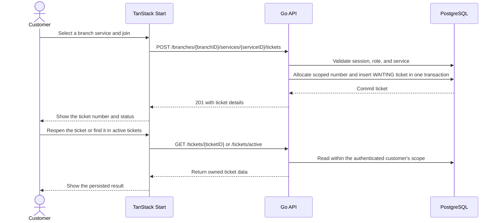
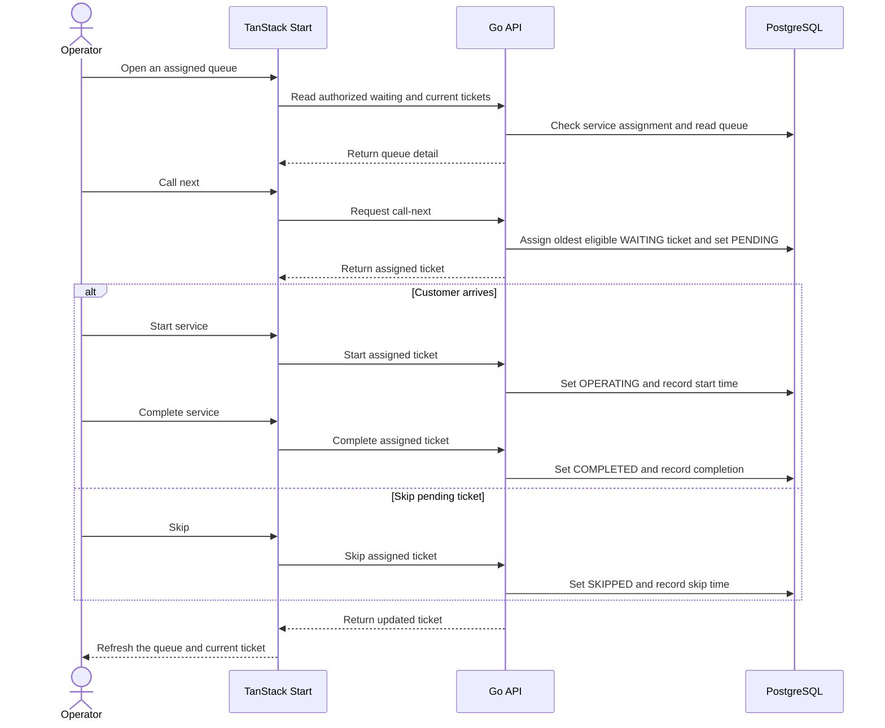
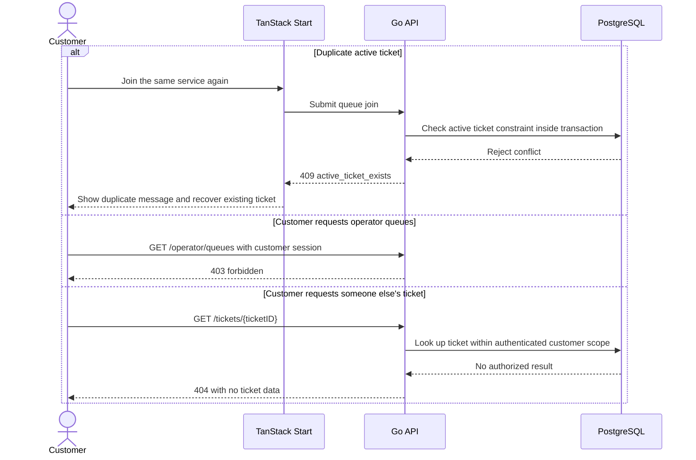

# Sprint 1 UML sequence diagrams

Scope and acceptance checks are in the [Sprint 1 release record](../sprints/sprint-1.md). The [system design](system-sds.md) covers the architecture, session lifecycle, and physical data model.

## Customer joins and recovers a ticket

## Operator processes the queue

## Duplicate and access denials

