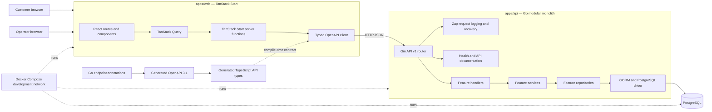
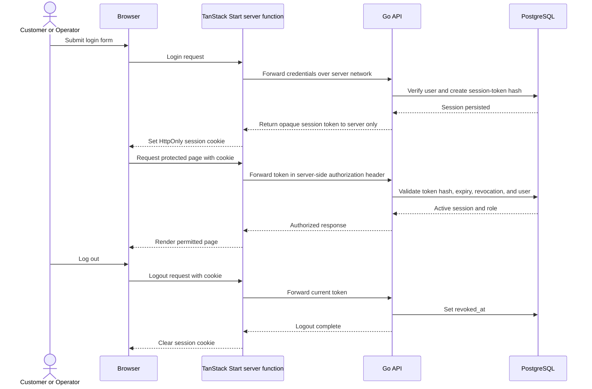
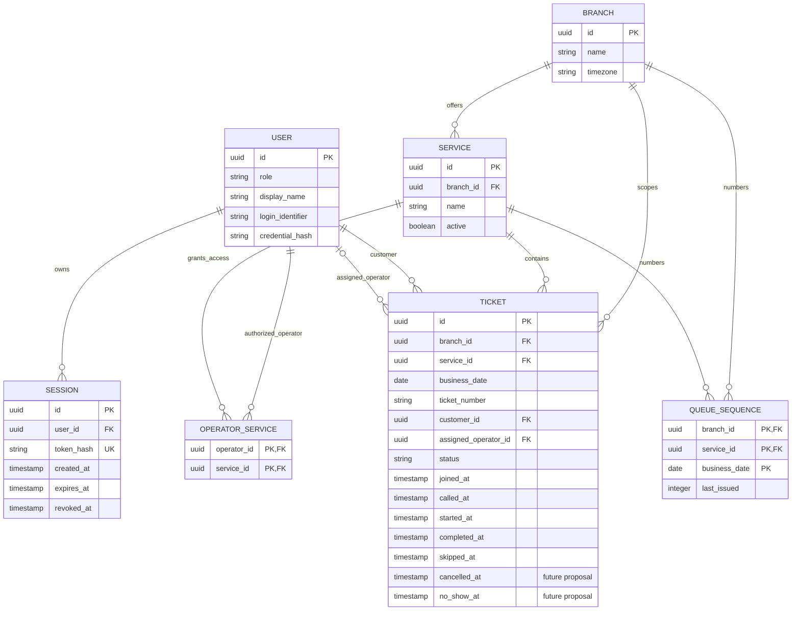

# Quevo System Design Specification

**Status:** Draft system-level design cross-checked against the supplied course specifications. Implemented authentication choices are recorded in [authentication.md](authentication.md); remaining design decisions stay marked as proposals.
**Product:** Quevo walk-in bank branch queue management
**Related requirements:** docs/requirements/srs.md, docs/requirements/features.md, docs/requirements/workflows.md
**Repository baseline inspected:** origin/staging after merge of PR #5

> This document describes intended architecture and remaining product behavior. Authentication endpoints and the web sign-in/session boundary are being implemented for issue #7; database migrations and seed data are owned by issue #15. Queue behavior remains a design target. The supplied group_work_specs_v1 is labeled draft for instructor review; project_deliverable_1_v1 is the supplied D1 v1. docs/requirements/traceability.md distinguishes those source clauses from Quevo design proposals.

## 1. Purpose and design goals

Quevo organizes walk-in customers into branch service queues and gives operators a controlled way to process tickets. The design keeps the current monorepo, framework choices, and feature-first modular monolith architecture.

Design goals:

- Keep queue and ticket state authoritative in PostgreSQL.
- Enforce ownership, role, queue authorization, and ticket assignment in the Go API.
- Make queue joins and ticket claims safe under concurrent requests.
- Keep browser code separate from secrets and server-only API configuration.
- Keep the API contract generated from Go documentation and use its OpenAPI types in the web app.
- Add only the module layers and infrastructure a feature needs.
- Keep local development and tests reproducible with the existing Compose, Go, Bun, and Testcontainers setup.

## 2. Scope and implementation status

| Area | Current repository | Intended product design |
| --- | --- | --- |
| API | Go HTTP server using Gin, GORM, Zap, and an API v1 router; health and auth routes are implemented. Auth persistence expects the users/sessions schema from issue #15. | Feature packages for identity, service discovery, and ticket workflows, wired explicitly through the app router. |
| Web | React and TypeScript with TanStack Start, TanStack Query, Bun, Tailwind, and shadcn. The web app has a login screen and server-managed session flow. | Customer and operator route groups call the Go API through TanStack Start server functions and typed API helpers. |
| Database | Optional GORM PostgreSQL pool; no application migrations yet. | PostgreSQL owns users, branches, services, operator-service authorization, sessions, queue numbering, and tickets. |
| Contract | OpenAPI 3.1 includes health and auth endpoints; TypeScript types are generated from it. | Every implemented endpoint has an OpenAPI contract; provider, client-type, and E2E checks verify it. |
| Tests | Starter unit/component and infrastructure tests, plus auth unit/provider tests and a PostgreSQL auth integration test. Queue behavior remains unimplemented. | Add tests with each feature. E2E runs the real web app and API against PostgreSQL. |
| Deployment | Local Compose network and multi-stage Dockerfiles. | Candidate Cloud Run services with Cloud SQL for PostgreSQL; Artifact Registry, Secret Manager, IAM service accounts, and Cloud Logging. Confirm topology in Lab 5; no cloud deployment is required for D1. |

This design document does not implement application behavior; see the current-repository column for implementation status.

## 3. System architecture

### 3.1 Component responsibilities

| Component | Responsibility |
| --- | --- |
| Browser UI | Render customer and operator workflows. Do not store API credentials or make server-only secrets available to browser JavaScript. |
| TanStack Start server functions | Act as the web-to-API boundary, read the web session cookie, call the API, and return serializable results to routes. |
| TanStack Query | Cache and coordinate server-function results; invalidate or refresh ticket views after mutations. PostgreSQL remains the source of truth. |
| OpenAPI client | Use generated TypeScript types to call API v1 operations from server-only code. |
| Gin router and middleware | Register API v1 route groups explicitly and apply request logging and panic recovery. |
| Feature packages | Own feature handlers and, when needed, service and repository logic. Keep business decisions out of Gin handlers and persistence details out of the web app. |
| Platform packages | Own shared infrastructure such as configuration and the reusable PostgreSQL connection pool. Avoid putting feature-specific policy here. |
| PostgreSQL | Persist accounts, authorizations, queue numbering, sessions, tickets, and lifecycle timestamps. Enforce invariants that must hold under concurrency. |
| OpenAPI generation | Generate the API document from Go annotations; generate frontend declarations from that document. Generated files are not edited by hand. |

A feature should start with only the files it needs. Add a service or repository layer when its logic or persistence warrants one. Do not create empty feature packages or generic abstractions in advance.

### 3.2 Proposed feature boundaries

| Feature area | Responsibilities |
| --- | --- |
| Identity | Login, logout, current-user identity, session validation, and role information. |
| Service discovery | List branch services available to an authenticated customer. Service administration is future scope. |
| Queue/tickets | Join a queue, issue and read tickets, list operator queues and ticket history, claim the next ticket, and perform valid state transitions. |
| App/platform | Route composition, config, database pool, logging middleware, and explicit migration execution. |

These are design boundaries. Final package names and file breakdown belong in feature-level contracts and implementation.

## 4. API conventions

### 4.1 General rules

- Prefix versioned product endpoints with /api/v1.
- Use JSON request and response bodies with explicit DTOs; do not serialize GORM models directly. Return a resource DTO for reads and successful commands; define a stable items-and-page-token shape if a collection needs pagination.
- Generate and validate OpenAPI 3.1 from the Go API contract. Regenerate the TypeScript declarations after contract changes.
- Validate request shape and field rules at the API boundary, then enforce domain rules in the feature service. Get the acting user from the validated server-side session. Do not accept customer IDs, operator IDs, roles, or authoritative ticket status from the browser.
- Use resource reads for queries and explicit command endpoints for ticket transitions. Do not allow clients to patch ticket status directly.
- Use stable error codes and avoid returning SQL, stack traces, credentials, or session tokens.
- All routes that access customer or operator data require authentication unless explicitly designated public, such as health.

### 4.2 Proposed endpoint shapes

These paths are examples for Step 4 contract design; they do not imply implemented routes.

| Operation | Example path | Authorization and behavior |
| --- | --- | --- |
| Login | POST /api/v1/auth/login | Public. Verify credentials and create a session. |
| Logout | POST /api/v1/auth/logout | Authenticated customer or operator. Revoke the current session. |
| Current identity | GET /api/v1/auth/me | Authenticated customer or operator. Return server-derived identity and role. |
| List available services | GET /api/v1/services?branchId={id} | Authenticated customer. Return services available at the branch. |
| Join queue | POST /api/v1/branches/{branchId}/services/{serviceId}/tickets | Authenticated customer. Create one active ticket and return its ticket number and status. |
| Read own ticket | GET /api/v1/tickets/{ticketId} | Authenticated customer who owns the ticket; enforce ownership on the server. |
| Operator queue overview | GET /api/v1/operator/queues | Authenticated operator. Return only authorized queues. |
| Waiting tickets | GET /api/v1/operator/branches/{branchId}/services/{serviceId}/tickets?status=WAITING | Authenticated operator authorized for that service. |
| Call next | POST /api/v1/operator/branches/{branchId}/services/{serviceId}/tickets/call-next | Authenticated authorized operator. Atomically assign the oldest eligible ticket and set PENDING. |
| Start service | POST /api/v1/operator/tickets/{ticketId}/start | Assigned operator; transition PENDING to OPERATING. |
| Complete service | POST /api/v1/operator/tickets/{ticketId}/complete | Assigned operator; transition OPERATING to COMPLETED. |
| Skip ticket | POST /api/v1/operator/tickets/{ticketId}/skip | Assigned operator; transition PENDING to SKIPPED. |
| Ticket history | GET /api/v1/operator/branches/{branchId}/services/{serviceId}/history | Authenticated operator authorized for that service; return the agreed COMPLETED and SKIPPED ticket history. |

The product queue is identified by branch, service, and branch-local business date. The exact public path, pagination, filters, ticket-number format, and response fields remain Step 4 decisions.

### 4.3 HTTP outcomes and error shape

| Situation | Proposed status |
| --- | --- |
| Read or transition succeeded | 200 OK |
| Ticket created | 201 Created |
| Logout succeeded with no response body | 204 No Content |
| Malformed request | 400 Bad Request |
| Missing or expired session | 401 Unauthorized |
| Authenticated identity lacks the role or queue permission | 403 Forbidden |
| Resource absent or intentionally hidden to protect ownership | 404 Not Found |
| Duplicate active ticket, stale/invalid transition, or conflicting active operator ticket | 409 Conflict |
| Well-formed request that fails field validation | 422 Unprocessable Entity |
| Unexpected service failure | 500 Internal Server Error |

Use one documented JSON error envelope with a stable machine-readable code, safe user-facing message, request ID, and optional field errors. Final names and exact mapping are set with the OpenAPI contracts. Do not expose whether an inaccessible customer ticket belongs to another user.

## 5. Web and UI conventions

- Keep the existing React, TypeScript, TanStack Start, TanStack Query, Bun, Tailwind v4, and shadcn stack.
- Use file-based TanStack Router routes grouped by customer and operator workflows. Route names should reflect user intent, such as customer services, customer ticket, operator overview, operator queue, and operator history.
- Use server functions for web-to-API traffic. Keep API_BASE_URL and session forwarding server-side.
- Use the generated OpenAPI TypeScript types with the existing typed fetch client. Do not duplicate API request or response interfaces by hand.
- Use TanStack Query for request caching and invalidation. After join/call/start/complete/skip, refresh the ticket or queue views affected by that command.
- Keep route components focused on the screen. Place reusable UI in components and shared request helpers in the existing client/lib areas.
- Handle unauthenticated, forbidden, empty, loading, and API-error states explicitly.
- Do not claim role-based navigation is security enforcement; the API must enforce permissions for every request.

Suggested route map, to be refined when contracts and UI acceptance criteria are written:

| User area | Route intent |
| --- | --- |
| Shared | Login and current-session recovery |
| Customer | Service selection, join confirmation, ticket status |
| Operator | Queue overview, waiting ticket list, completed/skipped history, ticket action |

### 5.1 Shared screen behavior

| Screen | Loading and empty behavior | Validation and errors |
| --- | --- | --- |
| Login | Keep the form visible while submitting; do not reveal whether an unknown account or wrong credential caused failure. | Validate required fields in the UI and API. Show a safe sign-in error; do not retain submitted passwords. |
| Customer service selection | Show a loading state while services load; show an explicit empty state when no service is available. | Explain service-load failures and offer retry. The API remains authoritative for service availability. |
| Join confirmation and ticket status | Disable duplicate submission while join is in flight; load the persisted ticket after success. | Show field errors for invalid input and a conflict message for duplicate/stale requests. Do not display another customer's ticket. |
| Operator queue overview/list | Show loading per view; show “no authorized queues” or “no waiting tickets” as distinct empty states. | Handle permission denial, network failure, and stale queue data. Refresh the list after a successful command. |
| Operator history | Show loading, an empty history state, and paginated results if pagination is selected. | Hide customer details outside the operator's authorized scope; handle expired session and API failures. |

Validate inputs in the browser for quick feedback and repeat every rule in the API. On mutation, show pending state, then refresh affected ticket and queue queries from persisted API results. Treat a stale transition as a conflict and explain the current allowed action; do not let a hidden/disabled control substitute for API authorization.

## 6. Authentication and session lifecycle

### 6.1 Proposed session model

Use an opaque, high-entropy session token. Persist only a cryptographic hash of the token in PostgreSQL with its user, creation, expiry, and revocation timestamps. The token is carried in a web-origin cookie and is never placed in browser JavaScript, URLs, or logs.

The API remains the authority for authentication and authorization. The web server function forwards the opaque token to the Go API in a server-to-server authorization header. The implemented token, password, role, expiry, cookie, and error choices are recorded in [authentication.md](authentication.md). Registration, recovery, and global session revocation remain out of scope.

### 6.2 Cookie and request protections

The web cookie uses HttpOnly, SameSite=Lax, Path=/, and Secure in production. Use HTTPS in deployed environments. TanStack Start's server-function request-origin checks protect state-changing web calls; Go independently validates the API session. Session expiry is bounded and expired/revoked cookies are cleared by the web server function.

Never log raw credentials, cookie values, authorization headers, password hashes, or session-token hashes. Rate limiting and account lockout policy require security review and are not yet specified.

### 6.3 Lifecycle rules

1. Login normalizes the identifier, verifies the bcrypt credential, and creates a new random session. Multiple sessions may coexist; logout revokes only the current session.
2. A protected request validates the session against server-side storage and derives the user ID and role from that record.
3. Logout revokes the current session in the API and clears the browser cookie.
4. Expired or revoked sessions receive 401 and cannot mutate data.
5. Role and queue authorization are checked independently on each protected operation; a valid session is not sufficient permission by itself.

If local passwords are used, store only a salted, purpose-built slow password hash; never store plaintext or reversible passwords. Seeded demo accounts are sufficient for the course scope. Self-registration, password recovery, email verification, and advanced account administration are not required by the supplied group specification. Use synthetic users and a local seed procedure; keep demo credentials and all production secrets out of Git and submitted documents.

Account registration, password reset, SSO, MFA, session lifetime, rotation, and global session revocation remain design decisions unless a feature contract requires them.

## 7. Role-permission matrix

| Capability | Anonymous | Customer | Operator |
| --- | --- | --- | --- |
| Health check and login | Allowed | Allowed | Allowed |
| Read authenticated identity | Denied | Own identity | Own identity |
| List services for customer selection | Denied | Allowed | No customer workflow |
| Join a service queue | Denied | Allowed for selected branch service | Denied |
| Read ticket | Denied | Own tickets only | Authorized tickets needed for operator workflow |
| Queue overview and WAITING tickets | Denied | Denied | Authorized service queues only |
| COMPLETED/SKIPPED history | Denied | Denied | Authorized service queues only |
| Call next | Denied | Denied | Authorized queue; only if operator has no active ticket |
| Start a ticket | Denied | Denied | Only assigned PENDING ticket |
| Complete a ticket | Denied | Denied | Only assigned OPERATING ticket |
| Skip a ticket | Denied | Denied | Only assigned PENDING ticket |
| Logout | Denied | Own current session | Own current session |
| Service, queue, counter, and operator-assignment administration | Denied | Denied | Not part of Sprint 1; any later management role and branch scope must be approved first. |
| Public queue display | No public display selected. If later approved, expose only explicitly allowed non-private status. | Not applicable | Not applicable |

The API derives the role from the authenticated account. It checks service authorization and ticket assignment on every operator command and checks customer ownership on every customer ticket read.

## 8. Ticket state transitions

| Current state | Next state | Actor and guards | Persisted effects |
| --- | --- | --- | --- |
| WAITING | PENDING | Authorized operator calls next; ticket is oldest eligible WAITING ticket; operator has no active ticket. | Set assigned operator and called_at atomically. |
| PENDING | OPERATING | Assigned operator starts service after customer arrival. | Set started_at. |
| OPERATING | COMPLETED | Assigned operator completes service. | Set completed_at. |
| PENDING | SKIPPED | Assigned operator skips the called customer. | Set skipped_at. |
| WAITING | CANCELLED (future) | Customer cancels their own ticket, if the later-sprint cancellation policy permits it. | Proposed cancelled_at; policy needs approval. |
| PENDING | NO_SHOW (future) | Authorized operator records no-show under an approved later-sprint policy. | Proposed no_show_at; timing and rejoin behavior need approval. |

WAITING, PENDING, and OPERATING are the proposed active states for duplicate-customer and active-operator rules. COMPLETED and SKIPPED are terminal in the Sprint 1 model. Theme 9 explicitly places cancellation/no-show handling in later sprints but does not define these exact transitions. The two future transitions above are Quevo proposals and must be approved before implementation. No other transition is accepted in the Sprint 1 model.

## 9. Conceptual data model

For the Sprint 1 slice, the service queue is a logical scope keyed by branch, service, and business date; it does not need to be a separate domain table. QueueSequence is a coordination record used to allocate ticket numbers and serialize queue mutations. Theme 9 lists multiple queues/counters as later-sprint work. If F-011 is retained, add and review explicit Queue, Counter, and operator-assignment entities in that feature contract; their relationship and ownership rules are not defined by the supplied brief, so this initial ERD does not choose them.

This ER diagram is conceptual. Exact PostgreSQL types, identifier format, indexes, and migration SQL belong in Step 4 feature contracts. In particular, login identifier fields and branch-local timezone rules must be agreed before implementation.

## 10. PostgreSQL constraints and transactional design

### 10.1 Invariants to enforce

| Invariant | Database protection |
| --- | --- |
| A login identity identifies one user. | Unique normalized login identifier, if email or another identifier is selected. |
| A service belongs to one branch. | Foreign key from service to branch; unique service/branch key for composite references. |
| One operator authorization per service. | Unique operator_id and service_id pair in OperatorService. |
| One queue-number counter per branch/service/business date. | Primary or unique key across branch_id, service_id, business_date. |
| Ticket number is unique in its agreed branch/service/date scope. | Unique constraint across branch_id, service_id, business_date, ticket_number. |
| Only Sprint 1 ticket states persist. | CHECK constraint for WAITING, PENDING, OPERATING, COMPLETED, SKIPPED. Add CANCELLED or NO_SHOW only in a reviewed migration after their policies are approved. |
| A customer has at most one active ticket in a queue. | Partial unique index across customer_id, branch_id, service_id, business_date for active statuses. |
| An operator has at most one active assigned ticket. | Partial unique index on assigned_operator_id for PENDING and OPERATING tickets. |
| Queue reads are efficient and FIFO. | Index on branch_id, service_id, business_date, status, joined_at, id. |
| Session token cannot map to multiple sessions. | Unique token_hash; expiry and revocation are checked by the API. |

Use foreign keys to preserve ticket ownership, service/branch consistency, session/user links, and operator/service permissions. Prefer RESTRICT for deleting branches, services, or users referenced by historical tickets. Do not cascade-delete queue history.

A state/timestamp check should require called_at for PENDING and later states, started_at for OPERATING and COMPLETED, completed_at for COMPLETED, and skipped_at for SKIPPED. These checks supplement API validation; they do not replace transition-specific authorization.

### 10.2 Queue join transaction

1. Begin a PostgreSQL transaction.
2. Confirm the branch service exists and is available to customers.
3. Ensure the QueueSequence row exists for the branch/service/business-date key, then lock it with SELECT FOR UPDATE.
4. Check for an existing active ticket for this customer and queue.
5. Increment last_issued while holding the row lock and format the next ticket number using the agreed policy.
6. Insert a WAITING ticket with customer, service, branch, number, and joined_at.
7. Commit. If any step fails, roll back both the counter increment and ticket insert.

The partial unique active-ticket index is the final concurrency guard if two joins race. Map its conflict to the documented conflict response without exposing database details.

### 10.3 Call-next transaction

1. Begin a PostgreSQL transaction.
2. Confirm the operator is authorized for the selected service.
3. Ensure and lock that queue's QueueSequence row. Joins and calls use the same per-queue lock so concurrent requests cannot pass the queue head.
4. Confirm the operator has no active ticket.
5. Select the oldest WAITING ticket ordered by joined_at and then immutable id, with a row lock.
6. Update that ticket to PENDING, assign the operator, and set called_at in the same transaction.
7. Commit and return the assigned ticket. If there is no waiting ticket, return the agreed empty-queue response without a state change.

Do not use SKIP LOCKED when strict FIFO is a requirement: it can allow another caller to move past a locked queue head. The partial unique operator index handles simultaneous calls made by the same operator in different queues; translate a uniqueness conflict into a safe conflict response.

### 10.4 Start, complete, and skip transactions

Use a conditional update or row-locked transaction that matches ticket ID, expected current state, and assigned operator ID. A command that matches no row must not change the ticket. Return a safe not-found or conflict response according to the final enumeration policy. Persist the state and matching timestamp together.

Use PostgreSQL transactions and constraints as the correctness boundary. Do not rely on a browser check, in-memory mutex, cache, or a read-then-write sequence without locking.

### 10.5 Database setup, migrations, and seed data

The repository currently has a PostgreSQL connection pool but no application schema migrations or domain seed data. Add versioned SQL migrations when the first persisted feature is implemented. A planned location is apps/api/internal/platform/database/migrations; choose a migration runner in that feature contract. Apply migrations through an explicit local/CI/release command before serving traffic. Never apply GORM AutoMigrate during API startup.

For local Compose, PostgreSQL 17 uses the existing named volume so database data survives container or application restarts. A clean environment starts the database, applies migrations, then runs an idempotent seed command that creates synthetic branch/service data and one Customer and one Operator account with operator-service authorization. Seed stable IDs and safe fixture data so the same demo state can be recreated; do not commit usable passwords or production secrets. Provide local demo credentials only through a safe local handoff/seed procedure.

Integration and E2E tests create isolated databases or disposable PostgreSQL containers, apply the same migrations, and seed unique test identities per run. Each test cleans up its own records/container so parallel or repeated runs do not share mutable ticket state. Production uses Cloud SQL durable storage and configured backups; retention and recovery objectives are Lab 5 decisions. These are design plans, not current implemented migrations or seeds.

## 11. Configuration and deployment

### 11.1 Configuration

| Setting | Current default or source | Use |
| --- | --- | --- |
| PORT | 8080 in API config | Go HTTP listen port. |
| DATABASE_URL | Unset for standalone API; set by Compose | PostgreSQL connection string. Queue features require a working database. |
| DB_MAX_IDLE_CONNS | 5 | PostgreSQL pool idle connection limit. |
| DB_MAX_OPEN_CONNS | 10 | PostgreSQL pool open connection limit. |
| DB_CONN_MAX_LIFETIME | 30m | Maximum pooled connection lifetime. |
| API_BASE_URL | http://localhost:8080 in web code; http://api:8080 in Compose | Server-side web-to-API destination. |
| Session configuration | Not implemented | Select TTL, cookie name, and any signing/encryption settings during the auth contract. |

Use environment injection for deployed configuration. Keep production credentials and session secrets out of Git. The current Compose credentials are for local development only.

### 11.2 Environments

| Environment | Design |
| --- | --- |
| Local development | Docker Compose runs PostgreSQL, API, and web on the explicit quevo bridge network. PostgreSQL data uses a named volume. API and web source mounts support development reloads. |
| CI | GitHub Actions runs formatting/lint and the test suites. Integration and E2E use disposable Testcontainers PostgreSQL instances. |
| Planned GCP target | Candidate: deploy the TanStack Start web server and Go API as separate Cloud Run services; store PostgreSQL data in Cloud SQL for PostgreSQL; publish images to Artifact Registry; inject database/session secrets from Secret Manager; give each service a least-privilege IAM service account; and send runtime logs to Cloud Logging. Cloud Run to Cloud SQL connectivity and API ingress policy need a Lab 5 design decision. |

This is a proposed component plan for D1's deployment design, not deployed infrastructure. Deliverable 1 does not require GCP deployment; the supplied course documents place actual Docker/CI/CD/GCP setup in Lab 5. Confirm region, network path, ingress, database backups, IAM bindings, and budget during Lab 5. See the [Cloud Run and Cloud SQL PostgreSQL connection guide](https://cloud.google.com/sql/docs/postgres/connect-instance-cloud-run) and [Cloud Run private networking guide](https://cloud.google.com/run/docs/securing/private-networking) for current platform options.

Run explicit versioned migrations as a release/deployment job before the new application version receives traffic. Do not run GORM AutoMigrate at server startup. Keep liveness separate from readiness: the current health route is a process health check; database readiness behavior must be specified when database-backed features are introduced.

## 12. Observability and failure behavior

- Keep structured Zap logs and the existing request middleware.
- Include request ID, route template, method, status, duration, and safe error code in request logs.
- Exclude passwords, cookies, authorization headers, raw session tokens, and unnecessary customer data.
- Return stable client errors for validation, authorization, duplicate joins, no-waiting-ticket, and invalid transition cases; log internal causes server-side.
- Add a readiness check that tests PostgreSQL only when the API requires it. Preserve the process liveness check for container restart decisions.
- Handle PostgreSQL timeouts and unavailable database errors as service failures; never report an uncommitted ticket as successful.

## 13. Verification architecture

| Test level | What it verifies | Existing approach |
| --- | --- | --- |
| Web unit/component | Route components and client behavior; MSW may stub API responses here. | Vitest, React Testing Library, MSW. |
| API unit | Pure validation, transition rules, and service behavior. | Go standard testing and httptest. |
| API integration | PostgreSQL constraints, transactions, ordering, and concurrent joins/claims. | Testcontainers-Go with real PostgreSQL. |
| Contract | Provider responses conform to generated OpenAPI; web types match generated schema. | kin-openapi, OpenAPI generation, openapi-typescript check. |
| Full-stack E2E | Customer/operator journeys and persisted state across browser, web server, API, and database. | Playwright with real Go API and Testcontainers PostgreSQL; no mocked backend. |

Authentication unit, provider-contract, web component, and PostgreSQL integration tests cover the current sign-in/session behavior and role/ownership policy. Queue transition and concurrency behavior remain unimplemented and untested.

## 14. Design decisions and open questions

| Decision | Current design position | Needs resolution |
| --- | --- | --- |
| Official course specifications | The supplied group_work_specs_v1 is labeled draft for instructor review; project_deliverable_1_v1 is the D1 v1 source. | Keep direct clauses and Quevo proposals distinguished in traceability.md; confirm draft/spec changes with the team. |
| Authentication | Opaque server-side sessions, bcrypt local passwords, `CUSTOMER`/`OPERATOR` roles, 12-hour default expiry, and a web-origin HttpOnly cookie with Go-side validation. See [authentication.md](authentication.md). | Issue #15 must create the agreed users/sessions schema and seeded accounts. Production identity providers and account recovery are out of scope. |
| Queue key and business date | Branch, service, and business date; calculate date in branch timezone. | Set timezone source, queue open/close rules, and ticket reset policy. |
| Ticket number | Unique within branch/service/business date. QueueSequence allocates it transactionally. | Confirm prefix, padding, start number, and whether gaps are acceptable after errors. |
| Operator authorization | OperatorService records access to a service; provisioned data is enough for the first vertical slice. | Confirm who creates/revokes assignments and whether counters are required in the baseline. |
| Customer notification | A notification step follows call-next. | Decide whether it is a staff action, in-app message, SMS, or another channel and define delivery guarantees. |
| Ticket history | Read-only COMPLETED and SKIPPED tickets for authorized services. | Decide retention, pagination, filters, and whether more audit history is required. |
| API error contract | One safe JSON error envelope with stable codes. | Set exact field names, codes, status mapping, and OpenAPI schemas in Step 4. |
| Deployment | Candidate Cloud Run web/API services, Cloud SQL PostgreSQL, Artifact Registry, Secret Manager, IAM service accounts, and Cloud Logging. | Confirm network, ingress, backups, IAM, region, and cost in Lab 5; D1 does not require actual cloud deployment. |

## 15. Requirements trace

| Design area | Related requirements and planned features |
| --- | --- |
| Identity, session, and permissions | FR-001–FR-003, FR-013; BR-006–BR-007, BR-010; NFR-002; F-001 |
| Service discovery and queue join | FR-004–FR-006, FR-014, FR-016; BR-002–BR-005, BR-012; NFR-001, NFR-004–NFR-006; F-002–F-004, F-009 |
| Ticket reads and operator views | FR-007–FR-008, FR-017; BR-006, BR-010, BR-012; NFR-002–NFR-006; F-004–F-005 |
| Ticket claim and Sprint 1 transitions | FR-009–FR-016; BR-001, BR-005–BR-012; NFR-001–NFR-002, NFR-006; F-006–F-009 |
| Theme 9 later-sprint work | FR-020–FR-022; BR-013–BR-014; F-011–F-014. Exact cancellation/no-show policies, priority applicability, and summary measures remain open. |
| Proposed future product scope | FR-018–FR-019, FR-023–FR-024; F-010–F-011, F-015, F-017. These are not stated rubric requirements. |
| Build, contract, tests, and deployment design | NFR-007 and D1 Part C; actual GCP setup belongs to Lab 5. |
