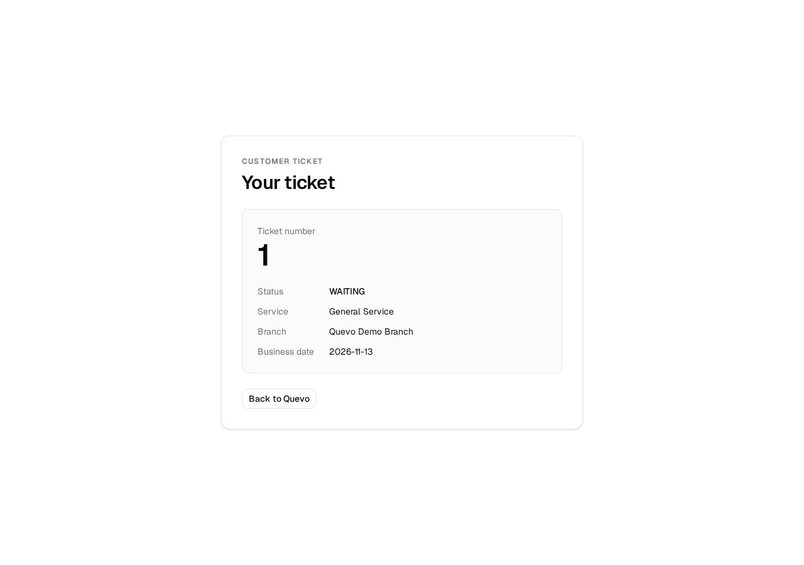
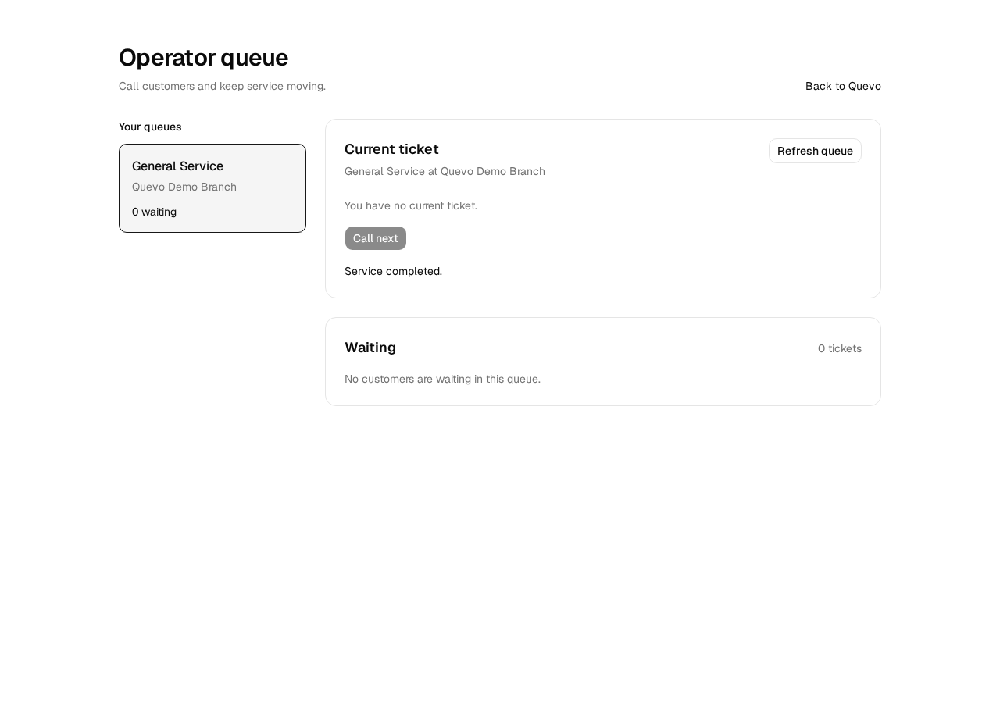

# C-03: clean-clone Docker packaging verification

Result: **PASS** for issue [#33](https://github.com/SupeemAFK/Quevo/issues/33).

Tested source: [`8397a66621a78e73ddff317fa1fa857feb386f72`](https://github.com/SupeemAFK/Quevo/commit/8397a66621a78e73ddff317fa1fa857feb386f72), cloned from the remote `test/docker-build-check` branch into `/tmp/quevo-c03-clean`. The checkout was clean before setup and remained clean after the run; see [source identity](00-source.log), [initial status](00-clean.log), and [final status](21-source-after.log). Later commits in this PR add evidence and explanatory documentation; the Dockerfiles, Compose configuration, lockfiles, and application code tested here are from this SHA.

Executed on 2026-11-13 at 18:30–18:35 UTC (2026-11-14 at 01:30–01:35 Asia/Bangkok), on Linux x86_64. Docker client 29.2.1 / server 29.9.3, Compose 5.7.0, host Go 1.27.3, GNU Make 4.4.1, and browser harness Node 22.18.0 / Chromium 156.0.8078.4. See [Docker versions](00-docker.log), [host toolchains](00-toolchains.log), and [browser output](16-browser.log). Node was used only for the external browser harness; the web app ran with Bun inside Docker.

## Setup and commands

The existing `quevo-db-1` container already occupied port 5432. The only configuration adaptation was to make the published database port configurable, preserving 5432 as the default. This run used `POSTGRES_PORT=55433` and `COMPOSE_PROJECT_NAME=quevo-c03` throughout. The internal API connection still used `db:5432`. A new database volume and a new web dependency volume were created; the existing database was not reused or stopped.

The remote clone command completed successfully:

```sh
git clone --branch test/docker-build-check --single-branch https://github.com/SupeemAFK/Quevo.git /tmp/quevo-c03-clean
cd /tmp/quevo-c03-clean
git rev-parse HEAD
git status --porcelain
export COMPOSE_PROJECT_NAME=quevo-c03
export POSTGRES_PORT=55433
```

The API environment file was generated from the tracked `apps/api/.env.example`, replacing the database placeholders with the disposable Compose database settings at localhost:55433 and generating two random local demo passwords. It was stored with mode 0600. No application source or lockfile was copied from the original working directory. No real credentials were used. The ignored `.env` file and password values are excluded from this evidence.

These setup steps follow the [deployment guide](../../deployment.md). The initial normal build passed, followed by a cache-free build that reinstalled image dependencies:

```sh
docker compose build
# Fill apps/api/.env from apps/api/.env.example as described above.
docker compose config --quiet
docker compose build --no-cache
docker compose up -d --wait db
make -C apps/api migrate-up
make -C apps/api seed-demo
docker compose up --build -d --wait
docker compose ps --all
curl -fsS http://localhost:8080/api/v1/health
curl -fsS -o /dev/null -w 'HTTP %{http_code}\n' http://localhost:3000
docker compose exec -T db pg_isready -U quevo -d quevo
```

The [capture harness](capture-command.py) saved command output and exit codes. Its defaults contain the paths from this run. Trailing whitespace was removed from log lines for Git whitespace checks; output content and exit codes were retained. The `$` display line joins arguments without shell quoting; the commands above and below preserve quoting needed for direct shell execution. Artifact checksums are in [SHA256SUMS](SHA256SUMS).

## Results and output

| Check | Observed result | Evidence |
| --- | --- | --- |
| Compose configuration | Exit 0 | [02-config.log](02-config.log) |
| Normal image build | Both images built, exit 0 | [01-build.log](01-build.log) |
| Cache-free image build | `go mod download` and `bun install --frozen-lockfile` ran; Bun installed 515 packages; both images built, exit 0 | [03-build-no-cache.log](03-build-no-cache.log) |
| Fresh PostgreSQL | New `quevo-c03_postgres-data` volume created; database healthy | [04-db.log](04-db.log) |
| Explicit migrations | `database migrations applied`, exit 0 | [05-migrate.log](05-migrate.log) |
| Explicit seed | `synthetic Quevo demo records seeded`, exit 0 | [06-seed.log](06-seed.log) |
| Full stack | API and database healthy; web running; `up --build -d --wait` exited 0 | [07-stack.log](07-stack.log), [20-final-status.log](20-final-status.log) |
| API health after startup | `{"status":"healthy"}`, exit 0 | [13-health.log](13-health.log) |
| Web HTTP | `HTTP 200`, exit 0 | [14-web.log](14-web.log) |
| Database readiness | `accepting connections`, exit 0 | [15-pg-ready.log](15-pg-ready.log) |
| Environment file exclusion | Filled API `.env` absent from image; web image also has no `.env` | [API check](08-env-exclusion.log), [web check](08-web-env-exclusion.log) |
| Real browser journey | Customer sign-in, ticket join/reload, operator sign-in/call/start/complete, customer reload to COMPLETED all passed | [16-browser.log](16-browser.log) |
| Committed database state | One COMPLETED ticket, two session records | [17-database.log](17-database.log) |
| Cleanup | All `quevo-c03` services, network, and both volumes removed; existing `quevo-db-1` still running | [22-cleanup.log](22-cleanup.log), [23-existing-stack.log](23-existing-stack.log) |

The [image identifiers](18-images.log) record the exact images used. The [service logs](19-logs.log) show the real API requests and PostgreSQL startup. They were captured without printing environment files, login payloads, session tokens, or password hashes. Text artifacts were checked against the disposable demo passwords before inclusion.

Two startup observations are retained rather than reported as application failures:

- Docker warned that buildx was unavailable and successfully used the classic builder. This run does not verify BuildKit-specific features.
- An early health probe ran while `docker compose up --wait` was still pending and returned curl exit 56 ([10-health.log](10-health.log)). The API was compiling on its first development-container start. After Compose finished, the same endpoint returned healthy ([13-health.log](13-health.log)). The intermediate states are in [09-status.log](09-status.log), [11-startup-logs.log](11-startup-logs.log), and [12-readiness.log](12-readiness.log).

## Browser evidence

The [exact browser harness](browser-check.cjs) ran against `http://localhost:3000` with separate customer and operator browser contexts, real server functions, the real API, and the fresh PostgreSQL database. It made no mocked responses. The harness read the disposable passwords from the ignored API `.env` without printing them. Playwright was supplied by the review workspace's existing `tests/node_modules`; those dependencies were not copied into the clean application checkout.

To rerun the harness against a newly seeded stack, install the repository's Playwright dependencies and Chromium as described in the root README, then supply absolute paths:

```sh
C03_PLAYWRIGHT_PACKAGE=/absolute/path/to/Quevo/tests/package.json \
C03_ENV_FILE=/absolute/path/to/clean-clone/apps/api/.env \
C03_EVIDENCE_DIR=/absolute/path/to/output-directory \
node docs/labs/lab-05/evidence/c03/browser-check.cjs
```

The output directory must already exist. The harness expects an empty, newly migrated and seeded database because it asserts ticket number 1. It creates and completes that ticket. The original invocation was `node /tmp/quevo-c03-browser.cjs`; the attached script is the same harness, including its original machine-specific fallback paths.

Customer ticket after a page reload, before operator service:



Operator after completing the ticket:



The final database check and cleanup commands were:

```sh
docker compose exec -T db psql -U quevo -d quevo -c 'SELECT status, count(*) AS tickets FROM tickets GROUP BY status; SELECT count(*) AS sessions FROM sessions;'
docker compose logs --no-color --tail=100 db api web
docker compose ps --all
git status --porcelain
docker compose down -v
```

## Scope

This checks the existing Dockerfiles, ignore rules, and **development** Compose targets from a clean remote clone, including a database-backed browser journey. Base images were available locally; the cache-free build bypassed Docker instruction caching, not base-image storage. Mutable image tags are identified in the attached image metadata. Production-target containers, GCP deployment, persistence across redeploys, and the full CI test suite were not exercised here; deployment and redeploy checks are tracked in #35 and #38.
