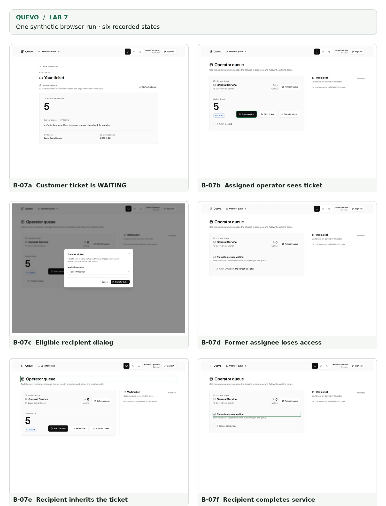
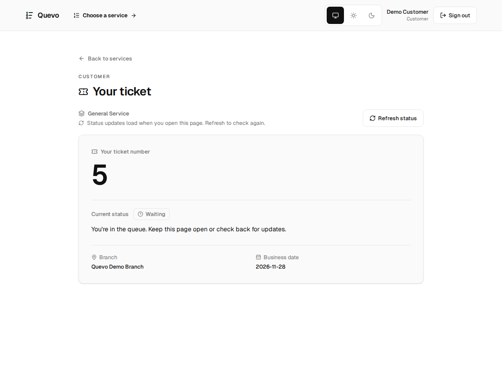
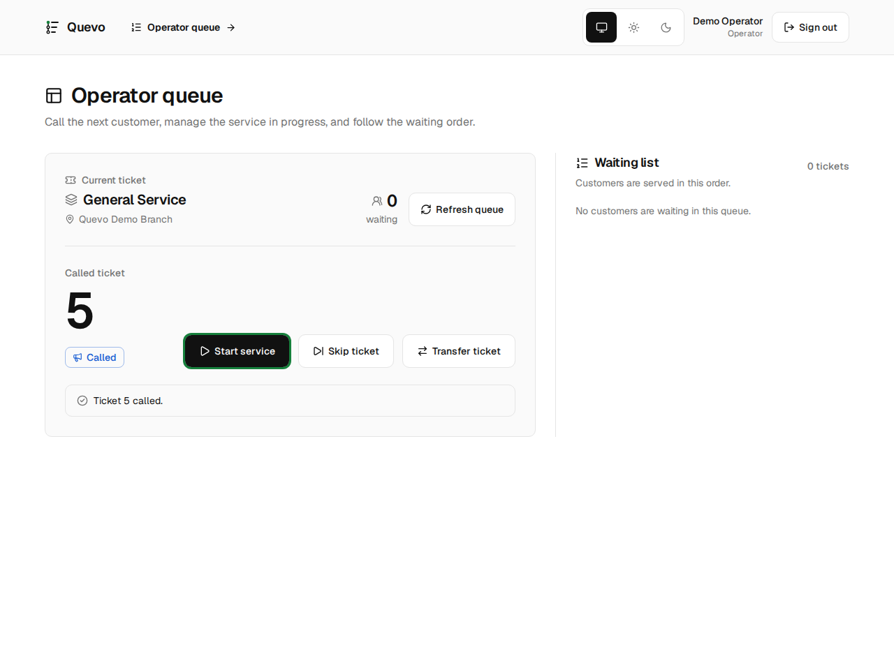
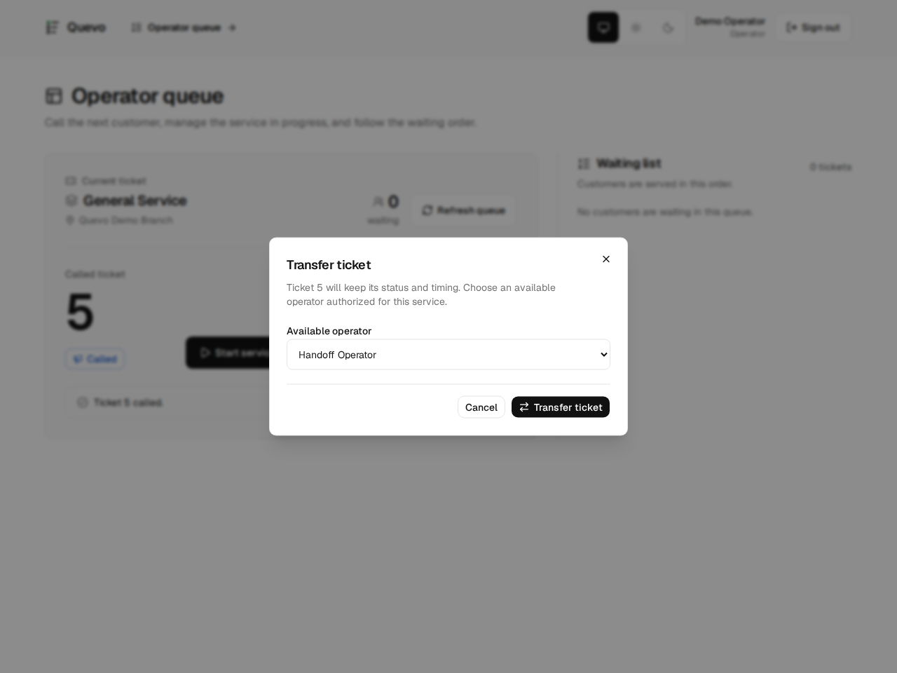
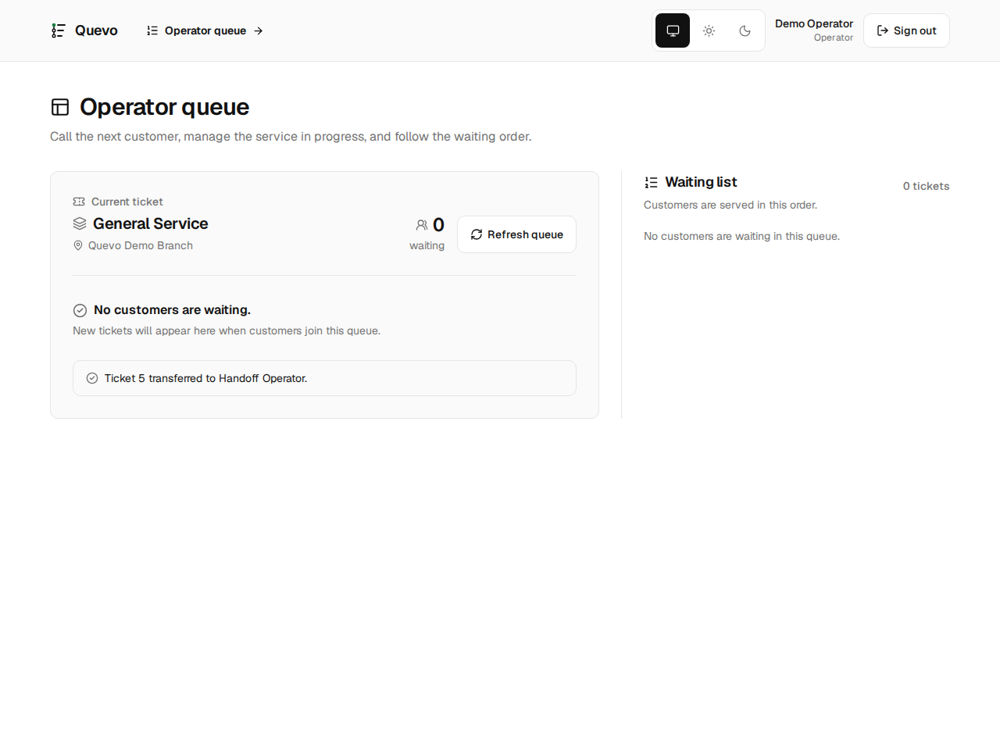
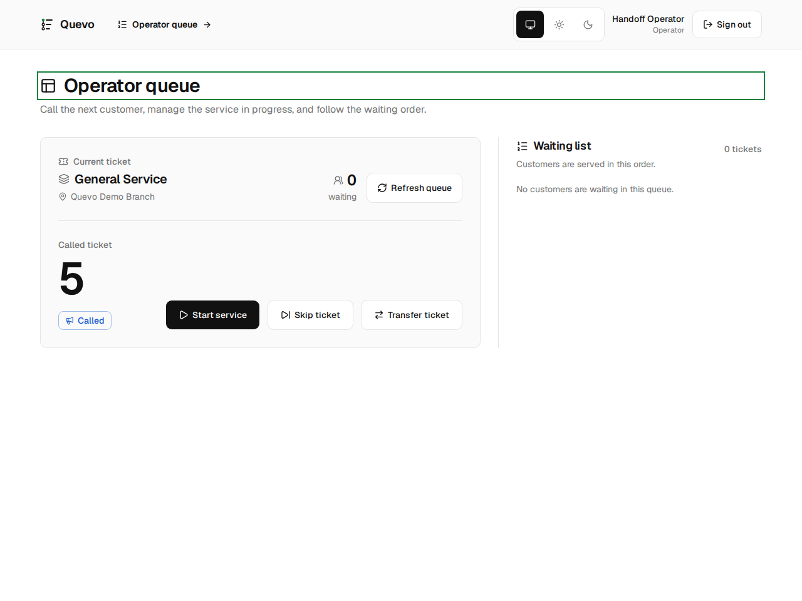
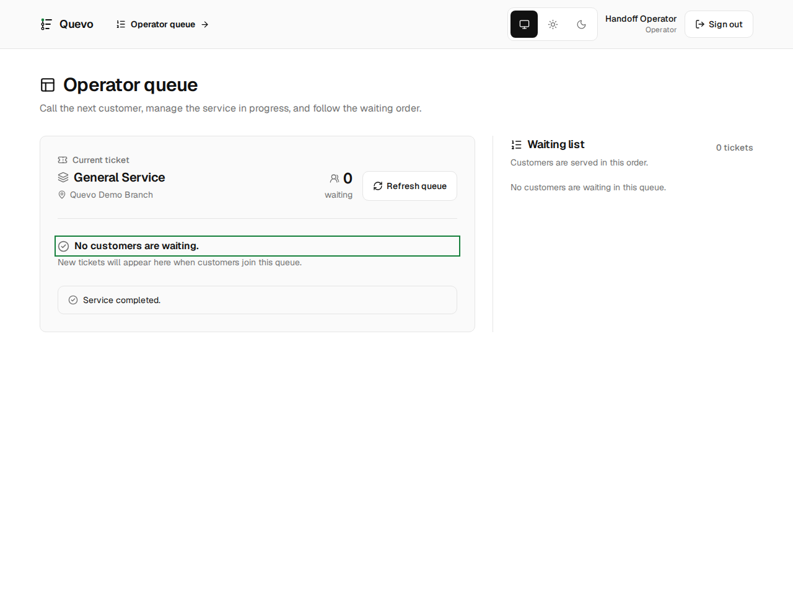

:::cover
**CPE334  /  SOFTWARE ENGINEERING**
# Lab 7
## Sprint 1 maintenance & release evidence

**PROJECT**  Quevo · in-person queue management

| TEAM | STUDENT CONTRIBUTORS |
| --- | --- |
| EN-046 · 2 Boys 1 Repo | Peeranat Ngamkiatkajorn · 67070503429; Peemmapat Sripongsai · 67070503436 |

**SUBMITTED VERSION**  Sprint 1 maintenance change CR-L7-01

**SUBMISSION FORMAT**  Self-contained A4 PDF · deadline 29 November 2026, 23:59 ICT

**REPORT SNAPSHOT**  28 November 2026 · 20:30 ICT

**READINESS**  READY for the maintained Sprint 1 scope and CR-L7-01.

**EVIDENCE NOTE**  Test accounts and tickets are synthetic; no secrets or production ticket data are shown.

**Repository:** [github.com/SupeemAFK/Quevo](https://github.com/SupeemAFK/Quevo)

> This dossier follows the change from its original Sprint 1 rule through contract review, implementation, independent code review, UAT, production deployment and evidence capture. Later-sprint work is outside this report’s release scope.
:::

[[PAGEBREAK]]

:::summary
## Executive summary

### What changed

CR-L7-01 lets the operator currently assigned to a called ticket hand it to another authorized, same-service operator who has no active ticket. The customer keeps the same ticket, status, queue position and lifecycle timestamps. The new assignment and audit record are committed together; the former operator loses authority and the recipient inherits the next valid action.

### Evidence at a glance

:::metric-grid
- **1** reviewed Sprint 1 change
- **11 / 11** UAT smoke assertions passed
- **9 / 9** browser E2E checks passed
- **6** original browser screenshots embedded
- **8 / 11** implementation CI runs passed; all 3 failed runs were corrected before merge
- **100%** production traffic on the latest verified Cloud Run revisions
:::

### Release result

The change merged to `staging` as `172729f`, passed an authenticated UAT smoke, then was promoted to `main` as `9e50d82`. The latest production deployment at the report snapshot was `2fadedb`; both production endpoints returned HTTP 200. The release identifier is the commit SHA; no Git tag was created.

### What this report can and cannot establish

The PDF contains the source excerpts, review decisions, test results, deployment records and original synthetic browser screenshots. UAT behavior was verified with an authenticated API smoke; the six visual journey captures came from Playwright CI. This is not represented as a separately observed human UAT session. Production verification was read-only and did not alter customer tickets.
:::

[[PAGEBREAK]]

## Contents and evidence map

| Section | Pages | Evidence IDs | Assessment focus |
| --- | --- | --- | --- |
| Executive summary | {{PAGE_SUMMARY}} | — | Change, result, scope and evidence at a glance |
| Discussion and decision log | {{PAGE_DISCUSSIONS}} | A-01–B-08 | Course guidance, contract and code review, release decisions |
| Step-by-step maintenance and release | {{PAGE_STEPS}} | A-01–B-08 | Ordered actions, outputs and release hand-off points |
| Version and release chain | {{PAGE_CHAIN}} | A-01, B-06–B-08 | Baseline, UAT, staging, main and production lineage |
| Part A — Change impact and updated contract | {{PAGE_PART_A}} | A-01–A-06 | Sprint 1 baseline, change, impact, revised contract and peer review |
| Part B — Implementation and regression-safe delivery | {{PAGE_PART_B}} | B-01–B-08 | RED/GREEN, code and migration, tests, CI, review, UAT and screenshots |
| Part C — Objective engineering metrics | {{PAGE_PART_C}} | C-01–C-04 | Five dated metrics, sources and evidence-based action |
| Part D — Readiness and retrospective | {{PAGE_PART_D}} | D-01–D-04 | Readiness, defects/debt, deployment, reflection and limitations |
| Evidence register and source notes | {{PAGE_EVIDENCE}} | A-01–D-04 | IDs, revisions, artifacts, links and limitations |

[[PAGEBREAK]]

## Discussion and decision log

This log records the substantive Lab 7 decisions and review conversations evidenced by the course announcement, PRs, issue history and CI runs. It excludes unrelated product-design conversations and PR #86 work, which is outside this release.

:::timeline
1. **Course scope · instructor announcement shared with the team.** The instructor announcement waived instructor/TA approval and asked each team to select a sufficiently complex change to an existing Sprint 1 behavior. The team selected operator ownership/handoff rather than adding an unrelated later-sprint feature.
2. **Contract review · 27 November, 23:54–23:56 ICT.** Peeranat reviewed the revised SRS/SDS in [PR #91](https://github.com/SupeemAFK/Quevo/pull/91) and approved with “Keep this plan.” The review was completed before the first implementation commit. PR #91 targeted a feature branch; its reviewed contract text was carried into the staging implementation.
3. **Change-request timing · 28 November.** Implementation had started before [issue #95](https://github.com/SupeemAFK/Quevo/issues/95) was created. The team records this as a process deviation; #95 is not presented as a pre-code approval. The earlier PR #91 review is the pre-code contract evidence.
4. **Initial implementation and CI · 05:56–06:22 ICT.** [PR #94](https://github.com/SupeemAFK/Quevo/pull/94) began with a staticcheck failure. The response/error mapping was corrected, and the following four full CI runs passed through `4352f9e`.
5. **Review decision changed · 11:19–11:29 ICT.** Peeranat’s detailed review on [PR #94](https://github.com/SupeemAFK/Quevo/pull/94) identified three merge gates: cover the recipient session in Playwright, restore keyboard focus after transfer, and test the specific migration ledger row. An initial approval at 11:20 was replaced by a changes-requested review at 11:29; merge remained blocked pending those fixes.
6. **Fix-and-rerun cycle · 14:33–15:03 ICT.** Two browser navigation assertions failed while the recipient journey was being corrected. The team fixed the path, focus recovery and migration assertion in `6126d1e`, `05c2b13` and `803262b`. [PR #94 CI history](https://github.com/SupeemAFK/Quevo/actions) then showed passes at 14:42, 14:50, 14:58 and 15:03.
7. **Final implementation review · 15:16–15:17 ICT.** Peeranat confirmed all three requested fixes, noted the full CI and latest PR-head check were green, and found no new actionable issues. PR #94 merged to `staging` at 15:17.
8. **UAT evidence requested and supplied · 15:49–17:21 ICT.** The team ran an 11-assertion authenticated smoke against UAT and recorded the result in [PR #97](https://github.com/SupeemAFK/Quevo/pull/97). The UAT API and web were on the implementation release; synthetic data was removed after the smoke.
9. **Production promotion review · 28 November, before 17:56 ICT.** [PR #96](https://github.com/SupeemAFK/Quevo/pull/96) review asked for explicit UAT-smoke evidence, then for the release/readiness record to reflect it. The team added the smoke record through PR #97 and updated the readiness evidence before PR #96 was approved and merged to `main` at 17:56.
10. **Post-deployment evidence · 19:11–20:30 ICT.** Documentation-only [PR #98](https://github.com/SupeemAFK/Quevo/pull/98) merged at 19:11 and triggered a deployment of unchanged app source. The report snapshot records the resulting revisions/digests, 100% traffic, and read-only HTTP 200 checks for the public web and API health endpoints.
:::

[[PAGEBREAK]]

## Step-by-step maintenance and release

Use this sequence to reproduce the evidence trail. The commit identifiers below distinguish the tested source from later documentation-only deployments.

:::process
1. **Anchor the change to Sprint 1.** Confirm the existing operator assignment/one-active-ticket rule in accepted baseline `82cd9c9` and actual pre-change staging/UAT SHA `675df62`. Write the proposed exception as a controlled handoff, not a new queue lifecycle.
2. **Revise the contract before coding.** Update the SRS, SDS and traceability; define eligibility, ownership, invalid cases, state preservation and audit behavior. Obtain Peeranat’s review and approval in PR #91. The instructor announcement means no separate instructor/TA approval was needed.
3. **Demonstrate the missing behavior.** Run `TestLab7HandoffOptionsAvailableToAssignedOperator` against pre-change SHA `675df62`. The authenticated options request returned 404 where the revised contract requires 200. Preserve the actual RED output; disclose that the test source was first committed with the implementation.
4. **Implement the smallest complete change.** Add authenticated options/handoff routes, server-side eligibility checks, one transaction for assignment plus audit event, the migration, the operator dialog, contract documentation and targeted tests. Keep ticket state and lifecycle timestamps unchanged.
5. **Run regression checks and respond to review.** Execute API/unit/integration, web, lint/type, migration and Playwright checks in CI. Address all three requested review fixes and each failed CI cause; do not merge while any check remains red.
6. **Merge to staging and deploy UAT.** Merge PR #94 as `172729f`; confirm migration job and immutable API/web images are deployed to the UAT revisions with 100% traffic.
7. **Run the UAT behavior smoke.** Authenticate as synthetic customer/operator accounts; verify owner reads, another customer denial, call-next, successful eligible handoff, preserved PENDING state and `called_at`, one audit row, former-assignee denial, and recipient start/complete. Remove test data and record all 11 results.
8. **Promote the reviewed release.** Use PR #96 to promote the staged feature SHA `9e50d82` to `main`. Supply the requested UAT and readiness evidence before approval. Keep the later-sprint PR #86 out of this Lab 7 scope.
9. **Verify production deployment without customer mutations.** Confirm the migration job, current API/web revisions, image digests, 100% traffic, and read-only web/API health responses. Do not exercise handoff against live customer tickets.
10. **Assemble and check the submission record.** Preserve the exact source SHAs, CI run IDs, review decisions, UAT assertions, original screenshots, production snapshot, limitations and contributor/AI statement in one self-contained A4 report.
:::

[[PAGEBREAK]]

## Version and release chain

### Release path at a glance

:::release-steps
1. **Accepted Sprint 1 · `82cd9c9`** — Existing assignment and operator-ownership behavior.
2. **Pre-change UAT · `675df62`** — Baseline deployed successfully; used as the RED target.
3. **Reviewed implementation · PR #94** — Peer-reviewed and merged to `staging` as `172729f`.
4. **Behavior-tested UAT · run `46125113341`** — 11/11 authenticated smoke assertions; synthetic data removed.
5. **Production promotion · PR #96** — Reviewed staging source merged to `main` as `9e50d82`.
6. **Latest recorded production · run `46143445046`** — Documentation-only follow-up deployment; same app source, verified image digests and 100% traffic.
:::

### Exact revisions and deployment evidence

| Point in chain | Commit / release | Evidence and meaning |
| --- | --- | --- |
| Accepted Sprint 1 baseline | `82cd9c9693ea4e73f514929a09960647d56ef0ca` | Lab 6 accepted behavior. The original rule already assigned a called ticket to its calling operator and limited an operator to one active ticket. |
| Actual pre-change staging candidate and deployed UAT | `675df626b77d048c5e1dcc20577907d7b9995d43` | Successful UAT deploy run `46041359641`. API revision `quevo-uat-api-sha-675df626b77d-a1`, digest `sha256:40ae5fc7809386c9c4ff04fc3dcfbf3951f6512394d4b093a2d087d9610b5990`; web revision `quevo-uat-web-sha-675df626b77d-a1`, digest `sha256:75ff9b6e35f5123bb08e2c3478963936cf531588913c027f430210fd319d90b6`. This is the code revision modified for CR-L7-01; it had the Sprint 1 assignment/workload rules but no handoff route. |
| Reviewed implementation merged to staging | `172729ff7b66874cfe8755dca7478a49061158e8` | PR #94; merged 28 Nov 2026, 15:17 ICT. |
| Behavior-tested UAT revision | `172729ff7b66` | UAT run `46125113341`; API and web each routed 100% to revision suffix `sha-172729ff7b66-a1`; 11/11 authenticated smoke assertions passed. |
| Latest UAT deployment in the record | `8132eded6f2f91a9a7a24a7bece7ecae56a33658` | UAT run `46134789501`; documentation-only commit after behavior smoke. No application code changed after UAT-01. |
| Feature promotion to main | `9e50d82f5b11ad5dae03090f4100b83468bc906f` | PR #96, merged 28 Nov at 17:56 ICT. This commit contains the Lab 7 implementation. No Git release tag was created; the SHA is the release identifier. |
| Latest production deployment at report snapshot | `2fadedbe6fce6595e6870facc2cc5716394b001d` | PR #98 was documentation-only and merged at 19:11 ICT. Main CD run `46143445046` rebuilt/redeployed the same application source and verified traffic and image digests. Current revisions: `quevo-api-sha-2fadedbe6fce-a1` and `quevo-web-sha-2fadedbe6fce-a1`. |

**Current production endpoints:** web `https://quevo-web-202441143194.asia-southeast1.run.app/`; API health `https://quevo-api-202441143194.asia-southeast1.run.app/api/v1/health`. Both returned HTTP 200 in the read-only check at 28 Nov 2026, 20:30 ICT. The current production image digests recorded by CD are API `sha256:419115d14aec5b58320df2ce6416d3a2c7d1ffe6c4be6765ae41a3f0afd4fe42` and web `sha256:50531e23e7b18ea792d819efb66b569b0fb1d1f572b6e27ca2281ffc24f654fc`.

**Behavior-tested UAT endpoints:** web `https://quevo-uat-web-202441143194.asia-southeast1.run.app/`; API `https://quevo-uat-api-202441143194.asia-southeast1.run.app`. The authenticated smoke ran against the API revision named above.

**Intervening work:** between the accepted baseline and pre-change staging were PR #85 (UI redesign), #87 (UAT workflow), #88 and #89 (Lab 6 validation exercise/test expectation), and #92 (required sign-in email fix). PR #86, the later bank-service workflow feature set, is not in the pre-change or Lab 7 production ancestry and is excluded from this maintenance scope. PR #91 is the pre-code contract-review record; it was merged into `feat/bank-queue-service-workflows`, not staging/main. Its reviewed contract changes were carried into PR #94. The feature-branch merge commit `8f819a9` itself is not claimed as an ancestor of the deployed release.

[[PAGEBREAK]]

## Part A — Change impact and updated contract

### A-01 · Change request and Sprint 1 baseline

**Change request:** CR-L7-01, “Revise Sprint 1 operator assignment for ticket handoff” ([Issue #95](https://github.com/SupeemAFK/Quevo/issues/95)). The issue was created after local implementation work had begun; it is not represented as a pre-code issue. The pre-code contract evidence is PR #91, described below. Issue #95 is a change request, not a defect.

**Product context and reason:** Quevo is a walk-in queue manager for branch services. Under the accepted flow, an operator calls a customer, owns the active ticket, and completes or skips that service. If the assigned operator becomes unavailable, the customer otherwise has to wait for that operator or rejoin and risk losing the existing ticket identity and service position. Handoff changes responsibility without changing the customer’s place in the queue or recorded service history.

| | Accepted Sprint 1 behavior (old rule) | CR-L7-01 behavior (new rule) |
| --- | --- | --- |
| Assignment | Call-next assigns the oldest eligible WAITING ticket to the calling operator and changes it to PENDING atomically. | The current assignee may transfer a PENDING or OPERATING ticket to another operator who is authorized for the same service and has no active ticket. |
| Authority | Only the assigned operator may start, complete, or skip; an operator may hold at most one active ticket. | The recipient becomes the assignee and receives the existing next valid actions; the former assignee loses authority. The one-active-ticket limit remains. |
| Ticket data | Ticket state, number, customer, service and timestamps are persisted. | Handoff updates the assignee and adds one audit record atomically. Ticket state, number, customer, service, queue position and lifecycle timestamps are preserved. |
| Invalid cases | A ticket has no reassignment operation. | Reject WAITING/terminal tickets, self-transfer, customer/non-assignee attempts, cross-service, unauthorized, nonexistent or busy recipients, with no partial write. |

The old behavior is grounded in the accepted baseline at commit `82cd9c9`, SRS FR-009–FR-016 and BR-006–BR-012, plus operator features F-005–F-009. The actual pre-change implementation is staging SHA `675df62`; it includes the same old rule and is the RED test target. CR-L7-01 amends the old rule; it is not a claim that ticket handoff existed in Sprint 1.

### A-02 · Approval and pre-code teammate review

The instructor’s Lab 7 announcement supplied by the team states: **“You need not get Instructor or TA Approval for your change request to Sprint 1. Think of a good change to Sprint 1 among yourselves.”** Instructor/TA approval was therefore not required for CR-L7-01.

The revised contract was submitted for teammate review in [PR #91](https://github.com/SupeemAFK/Quevo/pull/91), targeting `feat/bank-queue-service-workflows`. Peeranat (`jarbbie`) approved it at 23:54 ICT on 27 Nov 2026 with the review text: **“Keep this plan.”** PR #91 merged at 23:56 ICT. The first code implementation commit was created at 05:56 ICT on 28 Nov. The reviewed SRS/SDS change therefore preceded implementation. Its merge commit is on the feature branch; the equivalent contract text is included in PR #94 and the staging release.

**Sequence limitation disclosed:** the handoff-options test was executed RED on the actual pre-change revision, but Git first records `operator_handoff_contract_integration_test.go` in the same initial implementation commit (`eb1929c`). There is no separate test-only commit in the PR #94 history. The report does not claim that repository history proves a test-source commit before implementation. Issue #95 was also created after implementation started. These chronology gaps are recorded rather than hidden.

### A-03 · Revised contract excerpts

**Accepted Sprint 1 SRS excerpts, verbatim** (`docs/requirements/srs.md` at baseline `82cd9c9`):

```text
FR-009 The system shall let an operator call the next eligible waiting ticket in FIFO order, assign it to that operator, and move it to PENDING atomically.
FR-010 The system shall let only the operator assigned to a PENDING ticket start service and move it to OPERATING.
FR-011 The system shall let only the operator assigned to an OPERATING ticket complete service and move it to COMPLETED.
FR-012 The system shall let only the operator assigned to a PENDING ticket skip it and move it to SKIPPED.
BR-007 Only the operator assigned to a ticket may start, complete, or skip it.
BR-008 An operator may have at most one active ticket at a time.
```

**Approved revised SRS excerpts, verbatim** (PR #91 review; reproduced in the staging SRS):

```text
FR-013 The system shall enforce authentication, role, queue authorization, ticket assignment, customer ownership, and operator handoff eligibility checks on the server.
FR-025 The operator currently assigned to an active ticket shall be able to transfer it to another operator authorized for the same service and with no active ticket; the system shall preserve state and lifecycle timestamps and record the transfer.
BR-007 Only the operator assigned to a ticket may start, complete, or skip it. The current assignee may transfer an active PENDING or OPERATING ticket under BR-015.
BR-015 A handoff is allowed only from the current assignee of a PENDING or OPERATING ticket to a different same-service operator with no active ticket. Assignment and audit record commit atomically; status and lifecycle timestamps do not change.
```

**SDS revision:** API shapes and permissions are in `docs/design/system-sds.md` §§4.2 and 7; assignment semantics in §8; the `ticket_handoffs` audit entity in §9; atomic transfer transaction in §10.5. The feature contract and traceability were revised with the SRS in PR #91 and carried into PR #94.

### A-04 · Impact and traceability

| Requirement / feature | Callers and affected behavior | Contract tests / STS | Implementation modules and persistence | Not-applicable rationale |
| --- | --- | --- | --- | --- |
| FR-009, BR-001/005; F-006 Call next | FIFO call-next stays unchanged; concurrent call-next must still honor one-active-ticket invariant. | AC-HO-07; STS-HO-05; existing call-next PostgreSQL cases. | `apps/api/internal/queue/repository.go`; existing unique active-ticket index; SDS §10.3. | No change to ticket ordering or number generation. |
| FR-010–012, BR-007/009; F-007–008 Start/complete/skip | Only the current assignee may transition an active ticket; a recipient inherits the next permitted action. | AC-HO-01–04; STS-HO-02–04; `TestOperatorTicketHandoffWithPostgres`. | `operator_repository.go`, `operator_handler.go`, `routes/operator.tsx`; SDS §§4.2, 7–8; existing ownership checks remain authoritative. | Customer permissions and queue role model are unchanged. |
| FR-008/013; F-005 Operator queue | Assigned operator sees eligible choices; list excludes self, busy and wrong-service operators; POST revalidates. | AC-HO-03/05; STS-HO-01/04; handler authorization tests. | Operator API endpoints and handoff dialog in `apps/web/src/routes/operator.tsx`; SDS §§4.2, 7. | No new role, service administration, or cross-branch transfer. |
| FR-014, BR-008; F-009 concurrency | Recipient cannot acquire two active tickets, including a transfer racing with call-next. | AC-HO-05/07; STS-HO-04/05; race test in `TestOperatorTicketHandoffWithPostgres`. | PostgreSQL transaction locks and existing `tickets_one_active_ticket_per_operator` index; SDS §§10.3, 10.5. | Existing index is relied upon, not newly claimed as introduced by this change. |
| FR-015/016; BR-011/012; F-009 persistence | Successful handoff preserves lifecycle and committed ticket state and records who transferred to whom. | AC-HO-01/02; STS-HO-01/02; migration ledger and audit assertions. | Migration `000003_sprint1_ticket_handoffs`; `ticket_handoffs` audit table; SDS §§9, 10.5–10.6. | No backfill: no prior handoff events exist. Existing ticket rows need no rewrite. |
| New FR-025 / BR-015; overlay on F-005–F-009 | New permissioned handoff; no unrelated queue workflow. | AC-HO-01–07; STS-HO-01–05. | OpenAPI schema, Go API, PostgreSQL migration, React operator dialog and tests; SDS §§4.2, 7–10.5. | No payment, files, notifications, external services, customer UI, or service configuration is touched. |

**Unchanged behavior and regression protection:** FIFO selection, ticket numbers, customer ownership/read access, service authorization, existing ticket states and transitions, call/start/complete/skip actions, duplicate active-ticket restrictions, and join/call/start/complete timestamps. These are covered by the existing Go API/PostgreSQL suites, web component tests, and customer/operator Playwright journey. The UAT smoke specifically rechecked customer ownership, former-assignee denial, recipient start/complete and preserved `called_at`.

### A-05 · Acceptance criteria and software test specification

| AC | Preconditions and action | Expected result | STS |
| --- | --- | --- | --- |
| AC-HO-01 | Current assignee transfers PENDING ticket to idle authorized same-service operator. | Assignment changes; status, customer, service, number and `called_at` stay unchanged; one audit row. | STS-HO-01 |
| AC-HO-02 | Current assignee transfers OPERATING ticket. | Assignment changes; status and `started_at` stay unchanged; new assignee may complete. | STS-HO-02 |
| AC-HO-03 | Former assignee attempts a protected action after transfer. | Server denies it; no ticket mutation. | STS-HO-03 |
| AC-HO-04 | New assignee performs the next valid transition. | Existing transition succeeds. | STS-HO-02/03 |
| AC-HO-05 | Recipient is busy, wrong-service, not an operator, missing, or self. | Rejected; no assignment or audit write. | STS-HO-04 |
| AC-HO-06 | Customer, non-assignee, or terminal/WAITING ticket attempts transfer. | Rejected without partial mutation. | STS-HO-04 |
| AC-HO-07 | Handoff races call-next for the same recipient. | At most one active ticket is assigned; the losing transaction is rejected/rolled back. | STS-HO-05 |

| STS | Setup/action | Expected | Implemented evidence |
| --- | --- | --- | --- |
| STS-HO-01 | Seeded Postgres fixture; customer joins, assigned operator calls; request candidate list and transfer to eligible operator. | Authenticated route returns eligible recipient; assignment/audit are atomic and lifecycle fields are preserved. | `TestLab7HandoffOptionsAvailableToAssignedOperator`; `TestOperatorTicketHandoffWithPostgres`. |
| STS-HO-02 | Transfer an OPERATING ticket after service start. | `started_at` remains stable; recipient can complete. | `TestOperatorTicketHandoffWithPostgres`. |
| STS-HO-03 | Former and recipient operators attempt the next action. | Former assignee denied; recipient allowed. | PostgreSQL integration assertions and E2E recipient session. |
| STS-HO-04 | Try self, busy, wrong-service, non-assignee, customer and invalid-state transfers. | Expected 404/409/invalid-transition response; no partial write. | `TestOperatorTicketHandoffWithPostgres`. |
| STS-HO-05 | Concurrent handoff and call-next target the same operator. | Unique active-ticket invariant holds regardless of winner. | Concurrency case in `TestOperatorTicketHandoffWithPostgres`. |
| STS-REG-01 | Run existing API, persistence, web and browser suites. | Sprint 1 customer and operator paths remain functional. | CI run `46124024679`; current verification run `46146702527`. |

[[PAGEBREAK]]

## Part B — Implementation and regression-safe delivery

### B-01 · Test setup, assertions, RED and GREEN

**Test setup:** Go integration tests use the repository’s PostgreSQL fixture and seeded synthetic customer/operator/service; the route is exercised through the authenticated Gin HTTP router. The operator calls a WAITING ticket to create PENDING state, signs in, and requests `/api/v1/operator/tickets/{ticketID}/handoff-options`. The changed-contract test asserts HTTP 200 for the authorized current assignee. A second integration test covers pending/operating transfer, audit and lifecycle timestamps, former/new assignee access, invalid recipients, migration ledger, and a call-next race.

**Changed-behavior assertion from `operator_handoff_contract_integration_test.go`:**

```go
if response.Code != http.StatusOK {
    t.Fatalf("handoff options status = %d, want %d: %s", response.Code, http.StatusOK, response.Body.String())
}
```

**RED — actual pre-change implementation:** test `TestLab7HandoffOptionsAvailableToAssignedOperator`; pre-change SHA `675df626b77d048c5e1dcc20577907d7b9995d43`.

```text
GOCACHE=/tmp/quevo-go-build /usr/local/go/bin/go test -tags=integration ./internal/queue \
  -run '^TestLab7HandoffOptionsAvailableToAssignedOperator$' -count=1
--- FAIL: TestLab7HandoffOptionsAvailableToAssignedOperator
    handoff options status = 404, want 200: 404 page not found
FAIL
```

This is the missing route/behavior, not a build error or broken fixture. Existing login, queue creation and call-next setup completed before the new options request returned 404.

**GREEN — same assertion after implementation:** the same test passed on implementation PR CI head `6132d3e` (run `46080085875`); the full PostgreSQL integration suite was also green in that run.

```text
GOCACHE=/tmp/quevo-go-build /usr/local/go/bin/go test -tags=integration ./internal/queue \
  -run '^TestLab7HandoffOptionsAvailableToAssignedOperator$' -count=1
ok  example.com/quevo/apps/api/internal/queue
```

**Test-first record limitation:** the RED target and output are recorded; however, the test source file first appears in Git in initial implementation commit `eb1929c`, alongside the feature. Thus Git history does not prove a separate test-only commit before implementation. This does not change the old-revision failure result, but it is a process deviation from the Lab 7 preferred sequence.

### B-02 · Implementation and code/data effect

The change is deliberately narrow:

- API adds authenticated `GET .../handoff-options` and `POST .../handoff` endpoints; server verifies actor identity, assignment, role, service authorization, state and recipient workload.
- The handoff transaction locks the assigned ticket and recipient, updates only `assigned_operator_id`, inserts `ticket_handoffs`, and commits both or neither. The pre-existing unique active-ticket index remains a last concurrency guard.
- Migration `000003_sprint1_ticket_handoffs` adds an audit table and indexes, with a down migration. No existing ticket rows are rewritten.
- Operator UI adds an accessible recipient dialog, eligible-operator selection, loading/empty/error feedback and queue refresh. The customer flow is unchanged.
- OpenAPI and generated TypeScript schema include the two endpoints.

**Implementation excerpt from `apps/api/internal/queue/operator_repository.go`** (release source):

```go
UPDATE tickets SET assigned_operator_id = ? WHERE id = ?
  RETURNING id::text, ticket_number, status, assigned_operator_id::text

INSERT INTO ticket_handoffs
  (id, ticket_id, previous_operator_id, new_operator_id)
VALUES (?, ?, ?, ?) RETURNING transferred_at
```

These statements run in one GORM transaction. The update does not set status, called time, started time or completion time. The integration assertions compare those values before and after transfer and require one audit row.

**Actual code diff excerpt, abridged only to omit surrounding unchanged lines** (`git diff 675df62..172729f`, `operator_handler.go`):

```diff
 group.POST("/tickets/:ticketID/skip", h.skipTicket)
+group.GET("/tickets/:ticketID/handoff-options", h.listHandoffCandidates)
+group.POST("/tickets/:ticketID/handoff", h.handoffTicket)
 }
```

The migration adds only the audit structure needed for the changed rule:

```sql
CREATE TABLE ticket_handoffs (
    id UUID PRIMARY KEY,
    ticket_id UUID NOT NULL REFERENCES tickets(id) ON DELETE RESTRICT,
    previous_operator_id UUID NOT NULL REFERENCES users(id) ON DELETE RESTRICT,
    new_operator_id UUID NOT NULL REFERENCES users(id) ON DELETE RESTRICT,
    transferred_at TIMESTAMPTZ NOT NULL DEFAULT now(),
    CHECK (previous_operator_id <> new_operator_id)
);
```

**Change summary from actual pre-change SHA `675df62` to staging merge `172729f`:** 24 files changed. The change touched API docs/handlers/repository, one migration pair, API integration tests, operator UI/API client and E2E tests, plus SRS/SDS/traceability documentation. No later-sprint PR #86 files were included. This is a compact change inventory, not a replacement for the actual linked diff in [PR #94](https://github.com/SupeemAFK/Quevo/pull/94).

### B-03 · Regression and build verification

| Suite / check | Command and runtime | Result | Why it matters |
| --- | --- | --- | --- |
| Go unit tests | `go test ./...` · Go 1.26.5 | 4 test-bearing packages passed; 0 failed. Remaining packages had no test files. | Queue state and API logic regression. |
| Go + PostgreSQL integration | `go test -tags=integration ./...` · Go 1.26.5; PostgreSQL 17 service in CI | 6 test-bearing packages passed; 0 failed; migration, ownership, handoff and concurrency coverage included. | Assignment, audit, transaction and preserved database invariants. |
| Web component/unit tests | `bun run test -- --maxWorkers=1 --no-file-parallelism` · Bun 1.3.13 / Node 24.15.0 | 14 files / 60 tests passed; 0 failed. | Dialog state, operator queue and existing customer/operator UI. |
| Type and lint checks | `bun run typecheck`; `bun run lint`; `bun run check:api` | All passed; lint checked 63 files. | Type-safe UI/client and checked API contract. |
| Browser E2E | CI command `make test`; E2E target runs `cd tests && bun install --frozen-lockfile && bun run test` (`playwright test`) · Playwright Test 1.64.1 / Chromium. | 9 passed; 0 failed; 0 skipped in run `46146702527` at commit `83dd0fa`. | `tests/e2e/customer-queue.spec.ts`: customer join/recovery, operator action, transfer dialog, successful handoff, focus recovery and recipient completion. |
| Build/deploy artifacts | CI run `46124024679`; main CD `46143445046` | API/web production images built; migration and deploy succeeded; image digests matched deployed revisions. | Release package and infrastructure integration. |

Local Docker was unavailable, so the author’s local environment could not start Testcontainers. The PostgreSQL 17 integration tests were run in GitHub CI; they were not represented as locally executed.

### B-04 · CI run record for implementation PR #94

All 11 PR #94 CI runs and final outcomes, copied from the repository’s GitHub Actions records (UTC converted to Thailand time):

| Run | Head | Time, 28 Nov ICT | Outcome | Recorded reason / disposition |
| --- | --- | --- | --- | --- |
| `46079877876` | `aff7976` | 05:59 | **Failed** | Staticcheck flagged response/error mapping; corrected in `6132d3e`. |
| `46080085875` | `6132d3e` | 06:01 | Passed | GREEN integration assertion and full CI. |
| `46081073959` | `690a7a4` | 06:11 | Passed | Full CI. |
| `46081524297` | `67db6b0` | 06:16 | Passed | Full CI. |
| `46082115861` | `4352f9e` | 06:22 | Passed | Full CI; detailed teammate review followed. |
| `46121740761` | `6126d1e` | 14:33 | **Failed** | Browser navigation assertion after review fixes; recipient navigation was corrected in the follow-up. |
| `46122126910` | `05c2b13` | 14:38 | **Failed** | Browser navigation assertion persisted in the recipient journey; corrected by `803262b`. |
| `46122420288` | `803262b` | 14:42 | Passed | Browser handoff/recipient flow and full CI passed. |
| `46123022741` | `44edbed` | 14:50 | Passed | Full CI. |
| `46123593995` | `358ba9d` | 14:58 | Passed | Full CI. |
| `46124024679` | `9f1642f` | 15:03 | Passed | Latest PR #94 check before merge; full CI. |

**Metric:** 8 passed / 11 total = 72.7%; 3 failed / 11 = 27.3%; 0 cancelled. The three failed checks were fixed before staging merge; they remain visible in this report rather than being hidden by the final green run.

### B-05 · Teammate code review and integration

Peeranat’s substantive review on PR #94 at 11:19 ICT identified three merge-gating fixes: add Playwright coverage for the dialog/recipient flow, restore keyboard focus after successful transfer, and assert the specific migration-ledger row instead of hard-coding the migration count. The fixes were committed in `6126d1e`, `05c2b13` and `803262b` and rerun through CI.

**Reviewer’s technical assessment (PR #94, 28 Nov):**

> “The part that's hard to get right — atomically moving an active ticket without touching its state or lifecycle timestamps — is done correctly, and the concurrency story is defended in layers rather than in a browser check.”

**Final approval (15:16 ICT):**

> “The three requested fixes are addressed: the browser test covers handoff through the recipient session, focus returns to the queue after transfer, and the migration test checks the specific ledger entry. The full CI run for the implementation commit passed, and the latest PR-head check is green. I found no new actionable issues.”

| Review request | Response | Evidence after the fix |
| --- | --- | --- |
| Exercise a full handoff through a recipient operator session. | Extend the Playwright journey through recipient sign-in and service completion. | PR #94 CI latest run `46124024679`; later browser run `46146702527`; screenshots B-07e and B-07f. |
| Return keyboard focus to the queue after a successful transfer. | Restore focus to the queue control after the dialog closes. | Playwright handoff journey in PR #94; full E2E passed. |
| Assert the named migration ledger entry instead of assuming a fixed row count. | Query and assert the specific Lab 7 migration record. | PostgreSQL integration suite in CI; run `46124024679` passed. |

| Non-blocking review observation | Release disposition |
| --- | --- |
| Candidate lookup takes a row lock although POST revalidates. | Deferred; listed with impact and priority in D-02. |
| Lock-order relationship with CallNext needs a clear invariant. | Deferred; current concurrency tests remain in CI. |
| Audit row does not snapshot transfer-time status. | Deferred; not required by the current contract. |

PR #94 merged to `staging` at 15:17:24 ICT as `172729ff7b66874cfe8755dca7478a49061158e8`. The reviewer’s non-blocking observations that remain as deferred engineering debt are listed in Part D.

### B-06 · UAT deployment and post-deployment behavior smoke

**UAT release:** deploy run `46125113341`, staging SHA `172729ff7b66874cfe8755dca7478a49061158e8`. Database migration execution `quevo-uat-migrate-xvkpp` succeeded. Cloud Run API and web each served 100% traffic from revision suffix `sha-172729ff7b66-a1`; the deployed images matched the workflow’s immutable digests.

**UAT-01 — authenticated API smoke, 28 Nov 2026 at 15:49 ICT; API revision `quevo-uat-api-sha-172729ff7b66-a1`.** This was a manual authenticated API smoke using synthetic accounts and records; it was not an independent Lab 6 UAT session.

| # | Account / action | Expected and observed result | Result |
| --- | --- | --- | --- |
| 01 | Customer joins General Service. | Ticket 2 issued; HTTP 201. | PASS |
| 02 | Ticket owner reads their ticket. | Authorized read; HTTP 200. | PASS |
| 03 | A different customer reads that ticket. | Access denied; HTTP 404. | PASS |
| 04 | Operator A calls the waiting ticket. | State changes WAITING → PENDING. | PASS |
| 05 | Record state before handoff. | PENDING; Operator A assigned; `called_at` set; zero handoffs. | PASS |
| 06 | Operator A transfers to same-service idle Operator B. | Handoff accepted. | PASS |
| 07 | Read ticket state after transfer. | Ticket remains PENDING. | PASS |
| 08 | Compare lifecycle time. | `called_at` is identical before and after transfer. | PASS |
| 09 | Read audit record. | Exactly one Operator A → B audit row. | PASS |
| 10 | Former assignee starts service. | Former operator denied; HTTP 404. | PASS |
| 11 | Recipient starts/completes; customer reads ticket. | Recipient action succeeds; owner can read COMPLETED ticket. | PASS |

**Result:** 11/11 assertions passed. Synthetic test accounts and records were removed after the smoke.

The latest UAT redeployment (run `46134789501`, SHA `8132eded6f2f...`) followed a documentation-only staging merge. No app code changed after UAT-01. The UAT revisions were `quevo-uat-api-sha-8132eded6f2f-a1` and `quevo-uat-web-sha-8132eded6f2f-a1`.

[[PAGEBREAK]]

### B-07 · Browser evidence — synthetic Playwright run

The following six screenshots were captured by the actual Playwright customer/operator E2E path in CI run `46146702527` on 28 Nov 2026, approximately 19:51–19:54 ICT. The test uses isolated synthetic fixtures, not production data. The [CI run artifact](https://github.com/SupeemAFK/Quevo/actions/runs/46146702527/artifacts/15264051637) contains the original screenshot files. The screenshot-capture commit `83dd0fa` changes only the CI upload configuration and E2E test; `apps/` application code is unchanged from the main deployed source. Each image records the visible result and is reproduced at readable scale.

:::screenshot-detail
### B-07.0 · Six-screen journey overview

The contact sheet is an index only. It is assembled from the six original 1280 × 960 Playwright screenshots below; each unaltered original follows on its own page.


:::

[[PAGEBREAK]]

:::screenshot-detail
### B-07.1 · Customer ticket remains WAITING

**Evidence ID:** B-07a · **Action:** create a customer ticket before it is called. **Expected:** customer can see ticket number and WAITING state. **Actual:** synthetic ticket 5 appears as WAITING. **Version:** test commit `83dd0fa`; app source matches production application commit `9e50d82`. **Time:** 28 Nov 2026, 19:51–19:54 ICT, CI run `46146702527`.


:::

[[PAGEBREAK]]

:::screenshot-detail
### B-07.2 · Assigned operator holds active ticket

**Evidence ID:** B-07b · **Action:** operator calls the next ticket. **Expected:** current assignee sees the active ticket and the handoff action. **Actual:** ticket 5 is shown as Called with “Transfer ticket” available to the assigned operator. **Version/time:** same CI run and revisions as B-07a.


:::

[[PAGEBREAK]]

:::screenshot-detail
### B-07.3 · Eligible recipient selection

**Evidence ID:** B-07c · **Action:** open Transfer ticket. **Expected:** dialog offers an eligible same-service, idle operator and an explicit transfer action. **Actual:** “Handoff Operator” is selectable in the accessible dialog. **Version/time:** same CI run and revisions as B-07a.


:::

[[PAGEBREAK]]

:::screenshot-detail
### B-07.4 · Former assignee loses access

**Evidence ID:** B-07d · **Action:** complete the transfer and inspect the former operator queue. **Expected:** former assignee no longer owns the active ticket. **Actual:** the former operator’s queue has no current customer; the transfer success feedback is visible. **Version/time:** same CI run and revisions as B-07a.


:::

[[PAGEBREAK]]

:::screenshot-detail
### B-07.5 · Recipient inherits ticket and authority

**Evidence ID:** B-07e · **Action:** sign in as the recipient operator and open the queue. **Expected:** recipient sees the transferred current ticket and allowed actions. **Actual:** ticket 5 is active for the recipient and the next action is available. **Version/time:** same CI run and revisions as B-07a.

The green outline is the visible keyboard-focus indicator after the handoff; it is included to show that focus returns to the operator queue when the dialog closes.


:::

[[PAGEBREAK]]

:::screenshot-detail
### B-07.6 · Recipient completes service

**Evidence ID:** B-07f · **Action:** recipient completes the ticket. **Expected:** existing operator transition succeeds after handoff. **Actual:** completion confirmation appears and the ticket leaves the active queue. **Version/time:** same CI run and revisions as B-07a.

The focus outline on the completion state is also intentional keyboard-focus evidence from the browser journey.


:::

[[PAGEBREAK]]

### B-08 · Main promotion and production verification

[PR #96](https://github.com/SupeemAFK/Quevo/pull/96) promoted staging to `main` at 17:56 ICT on 28 Nov, merge SHA `9e50d82f5b11ad5dae03090f4100b83468bc906f`. It received teammate review; the reviewer confirmed UAT and the recorded smoke checks before approval. Main CD run `46137488769` passed. A documentation-only PR #98 then merged at 19:11 ICT as `2fadedbe6fce6595e6870facc2cc5716394b001d`, triggering the latest main CD run `46143445046`.

**PROD-01 — latest deployment evidence from run `46143445046`, 28 Nov 2026:**

```text
Main commit: 2fadedbe6fce6595e6870facc2cc5716394b001d
Migration job: quevo-migrate updated and executed successfully
API revision: quevo-api-sha-2fadedbe6fce-a1 — 100% traffic
Web revision: quevo-web-sha-2fadedbe6fce-a1 — 100% traffic
API image: sha256:419115d14aec5b58320df2ce6416d3a2c7d1ffe6c4be6765ae41a3f0afd4fe42
Web image: sha256:50531e23e7b18ea792d819efb66b569b0fb1d1f572b6e27ca2281ffc24f654fc
Live read-only check at 20:30 ICT: production web HTTP 200; API health HTTP 200
```

The production workflow verified that each deployed revision’s image digest matched the immutable image and that exactly 100% of traffic routed to the latest revision. The Lab 7 handoff itself was not mutated on production; its behavior was verified with UAT API smoke and browser E2E evidence. PR #98 was documentation-only; the application code remains the reviewed PR #96 source.

[[PAGEBREAK]]

## Part C — Objective engineering metrics

### C-01 · Dated metric snapshot and embedded source records

Snapshot time: 28 Nov 2026, 20:30 ICT. Scope: CR-L7-01 and its staging/UAT/main release sequence in `SupeemAFK/Quevo`. A zero defect count means no handoff defect issue was identified in this scope; it is not a claim that unrelated product areas are defect-free.

| ID | Definition, scope and observation window | Value | Embedded source evidence |
| --- | --- | --- | --- |
| M1 — merged PRs | Pull requests for contract review, Lab 7 implementation, UAT evidence, promotion and final production evidence; 27 Nov 23:56–28 Nov 19:12 ICT. | 5 merged PRs. | Source list C-02. Targets/dates are included below; #91 targeted a feature branch and was contract-only. |
| M2 — implementation CI outcomes | Every CI run on PR #94 from first run through merge; 28 Nov 05:59–15:03 ICT. | 11 total: 8 pass, 3 fail, 0 cancelled (72.7% pass; 8/11). | Source list C-03 lists every run, short SHA, and outcome. |
| M3 — final browser suite | Chromium E2E suite on screenshot evidence commit `83dd0fa`, CI run `46146702527`, completed 28 Nov 19:54 ICT. | 9 passed; 0 failed; 0 skipped. | Run `46146702527`; six embedded screenshots B-07a–B-07f are captured during the run. |
| M4 — UAT handoff smoke | Authenticated synthetic API assertions on behavior-tested UAT SHA `172729f`, 28 Nov 15:49 ICT. | 11/11 assertions passed; 0 failed; temporary test data removed. | Source excerpt UAT-01 in B-06; UAT deploy run `46125113341`. |
| M5 — handoff defects | GitHub issue status for CR-L7-01 at snapshot time; change request separated from defect reports. | 0 handoff defect issues; 1 change request (#95), closed as completed at 20:23 ICT. | Issue #95 body/history and PR #94 review record; no handoff defect was filed. |

### C-02 · M1 source list — pull-request IDs, targets and merge times

| PR | Purpose | Target branch | Merged, ICT | Relation to delivered change |
| --- | --- | --- | --- | --- |
| #91 | Reviewed contract amendment | `feat/bank-queue-service-workflows` | 27 Nov, 23:56 | Pre-code documentation review; equivalent contract carried into #94. |
| #94 | Handoff implementation and tests | `staging` | 28 Nov, 15:17 | Feature implementation and staging integration. |
| #97 | UAT revisions and smoke evidence | `staging` | 28 Nov, 17:21 | Documentation-only UAT evidence update. |
| #96 | Staging release promotion | `main` | 28 Nov, 17:56 | Production application release. |
| #98 | Production deployment evidence | `main` | 28 Nov, 19:11 | Documentation-only; caused a later deployment of unchanged application source. |

### C-03 · M2 source list — all PR #94 CI results

```text
46079877876 failure  aff7976  staticcheck response mapping
46080085875 success  6132d3e
46081073959 success  690a7a4
46081524297 success  67db6b0
46082115861 success  4352f9e
46121740761 failure  6126d1e  E2E navigation assertion
46122126910 failure  05c2b13  E2E navigation assertion
46122420288 success  803262b
46123022741 success  44edbed
46123593995 success  358ba9d
46124024679 success  9f1642f  latest PR #94 CI before merge
```

### C-04 · Evidence-based action (70 words; under the 100-word limit)

Three of the eleven PR #94 CI runs failed before the staging merge: one staticcheck issue and two brittle browser-navigation expectations. Keep the handoff browser journey and PostgreSQL concurrency test as required CI gates, and keep the failure causes visible in release notes. **Owner:** Peemmapat maintains the E2E and database regression cases; Peeranat reviews them. **Next milestone:** both checks must pass on the next main-release candidate before its production promotion.

[[PAGEBREAK]]

## Part D — Readiness and retrospective

### D-01 · Release-readiness checklist

| Check | Status and evidence | Owner / action |
| --- | --- | --- |
| Submitted/deployed version | Main feature release `9e50d82`; current deployment at report snapshot `2fadedb`; latest production revisions `quevo-api-sha-2fadedbe6fce-a1` / `quevo-web-sha-2fadedbe6fce-a1`. | Recorded in version chain; no release tag exists. |
| Defects | No P0/P1/P2/P3 handoff defect was filed or remains open. CR #95 is the completed change request, not a defect. CI/review issues were corrected before staging merge. | No unresolved known handoff defect. |
| Automated results | PR #94 full CI passed after corrections; final browser run 9/9, web 60/60, Go unit and Postgres suites passed; no final-suite failures/skips. Earlier 3 CI failures disclosed in B-04. | Continue mandatory regression gates. |
| User/deployed checks | UAT-01 11/11 authenticated API checks; six synthetic Chromium screenshots; production API health and web root both returned HTTP 200. | No production ticket was mutated. |
| Technical debt | Deferred review observations: handoff-options GET still takes a row lock though POST revalidates; opposite lock order relies on current CallNext behavior; audit record does not snapshot the status at transfer. Details/priorities below. | Keep concurrency tests; document or resolve before adding another assignment/reassignment workflow. |
| Configuration/secrets | No new runtime secret/configuration was added. CI ran the existing migration job on UAT and production; secret values are absent from this report. | Existing Cloud Run and Secret Manager configuration retained. |
| Docs/run instructions | SRS, SDS, traceability, test contract and change record updated. UAT/prod pipelines remain the repository’s existing GitHub Actions workflows. | Submit the separately rendered self-contained PDF through LEB2; retain the Markdown source and evidence images in the repository. |
| Deployment/smoke | UAT migration/deploy/image checks passed; production migration/deploy/image/traffic checks passed; current public endpoints HTTP 200. | READY for maintained Sprint 1 scope + CR-L7-01. |

### D-02 · Defects versus deferred technical debt

| Item | Type / severity | Impact | Priority | Owner / disposition / action |
| --- | --- | --- | --- | --- |
| No known handoff defect at snapshot | Defect status | P0: 0; P1: 0; P2: 0; P3: 0. UAT smoke and E2E passed; no handoff defect issue was filed. | None | Peemmapat monitors reports; Peeranat reviews any reproducible report. CR #95 is closed as the completed change request. |
| Candidate lookup uses `FOR UPDATE` in `ListHandoffCandidates` | Technical debt | Advisory GET serializes against ticket changes; POST independently revalidates under lock, so the read lock appears unnecessary. | P3 | Proposed owner: Peemmapat; Peeranat reviews. Consider converting candidate lookup to a plain read; preserve POST revalidation and concurrency coverage. |
| Lock-order relationship to `CallNext` is not documented at both query sites | Technical debt | Current code is safe under the documented current CallNext behavior, but a future flow that takes locks in reverse order could introduce a deadlock cycle. | P2 | Proposed owner: Peemmapat; Peeranat reviews. Document the invariant or standardize lock order before another assignment/admin workflow is added. |
| Audit event does not snapshot status at transfer time | Technical debt | Current state can be inferred from lifecycle timestamps for present reporting, but future audit/reporting may need exact transfer-state evidence. | P3 | Proposed owner: Peemmapat; Peeranat reviews. Revisit if audit/report requirements need historical state without inference. |

These are deferred improvements from the reviewer’s non-blocking notes, not known incorrect behavior and not release blockers. The reviewer’s final approval found no new actionable issues after the three requested fixes.

### D-03 · Three retrospective answers

- **What helped?** The pre-code contract review made ownership, state preservation and invalid cases explicit. The PostgreSQL transaction/race tests and teammate review caught the missing browser path, keyboard-focus recovery and brittle migration-count assertion before staging merge.
- **What hurt?** Issue #95 was created after implementation started, and the test source was committed with the implementation rather than as a separate test-only commit. Three early CI attempts also failed before corrections.
- **What will change before final delivery?** Create the change issue and commit the revised test/contract before implementation. Keep the current E2E and database concurrency gates, then attach release SHA, deployment run, image digests and selected smoke results to every promotion record.

### D-04 · Contributions, AI use and limitations

| Contributor | Recorded contribution |
| --- | --- |
| Peemmapat Sripongsai (67070503436) | Implemented API, database migration, operator dialog, integration/E2E tests, review fixes and release evidence. |
| Peeranat Ngamkiatkajorn (67070503429) | Reviewed the contract before implementation; gave substantive code review, required three corrections, re-reviewed and approved the implementation and release evidence. |
| Codex AI assistant | Assisted with implementation, test/evidence collection and report drafting. The student team reviewed and accepted the work; AI output is not represented as teammate approval. |

**Known limitations:** (1) the RED result was run against the pre-change SHA, but Git history does not show a separate test-only commit before implementation; (2) Issue #95 was opened after implementation began; (3) PostgreSQL integration tests ran in CI because local Docker/Testcontainers were unavailable; (4) UAT behavior verification was an authenticated API smoke, while browser interaction evidence is synthetic Playwright CI, not a separately recorded human UAT session; (5) production verification checked deployment, digest, traffic and public health/root endpoints, but did not mutate production ticket data. All five limitations are disclosed in the readiness decision.

[[PAGEBREAK]]

## Evidence register and source notes

| Evidence ID | Embedded evidence | Source / revision |
| --- | --- | --- |
| A-01–A-06 | Change request, baseline vs new rule, course approval waiver, peer review, SRS/SDS excerpts, impact matrix, AC and STS. | Issue #95; PR #91; baseline `82cd9c9`; pre-change `675df62`; staging `172729f`. |
| B-01 | RED failure and GREEN pass output, test setup and source-history limitation. | Pre-change `675df626...`; CI run `46080085875` at `6132d3e`; test `TestLab7HandoffOptionsAvailableToAssignedOperator`. |
| B-02 | Implementation excerpt, migration and change inventory. | PR #94; staging `172729ff...`; Go repository and migration files. |
| B-03–B-04 | Suite commands, versions, pass/fail/skip counts and all 11 PR #94 run outcomes. | CI runs listed in B-04; latest browser run `46146702527`. |
| B-05 | Actual peer-review findings, fix commits and approval excerpts. | PR #94 review by `jarbbie`; fix commits `6126d1e`, `05c2b13`, `803262b`. |
| B-06 | Authenticated UAT smoke assertions and cleanup. | UAT deployment run `46125113341`; API revision `quevo-uat-api-sha-172729ff7b66-a1`; smoke timestamp 15:49 ICT. |
| B-07.0 | Contact sheet index assembled from the six original screenshots; originals are reproduced individually on the following pages. | Playwright CI run `46146702527`, test commit `83dd0fa`, synthetic fixture. |
| B-07a–B-07f | Six original embedded customer/operator screenshots from the complete transfer journey. | Playwright CI run `46146702527`, test commit `83dd0fa`, synthetic fixture. |
| B-08 / PROD-01 | Main release, latest Cloud Run revisions, immutable digests, 100% traffic and live HTTP checks. | PR #96; PR #98; CD run `46143445046`; live checks 28 Nov 20:30 ICT. |
| C-01–C-04 | Five metrics, embedded merged-PR list, CI source list and action. | GitHub PR/issue/Actions records within repository `SupeemAFK/Quevo`; snapshot 28 Nov 20:30 ICT. |
| D-01–D-04 | Readiness, defect/debt distinction, reflection, pair contribution, AI statement and limitations. | Release and verification records above. |

**Source links for targeted corroboration:** [PR #91 contract review](https://github.com/SupeemAFK/Quevo/pull/91) · [PR #94 implementation and review](https://github.com/SupeemAFK/Quevo/pull/94) · [UAT deployment run](https://github.com/SupeemAFK/Quevo/actions/runs/46125113341) · [UAT evidence PR #97](https://github.com/SupeemAFK/Quevo/pull/97) · [production promotion PR #96](https://github.com/SupeemAFK/Quevo/pull/96) · [latest production CD run](https://github.com/SupeemAFK/Quevo/actions/runs/46143445046) · [screenshot CI run](https://github.com/SupeemAFK/Quevo/actions/runs/46146702527).
