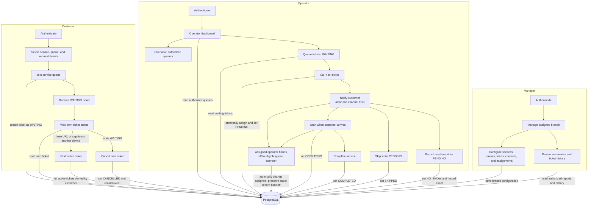

# User Journeys and Ticket Lifecycle

**Status:** Customer joining/status, operator processing, branch management, service request forms, cancellation, no-show, ticket history, and periodic queue refresh are implemented. See [branch management and customer documents](../branch-management.md) for manager scope and attachment limitations.
**Sources:** group_work_specs_v1.pdf §6 Theme 9 and the user-provided diagrams.

A queue is the shared line for a branch service. A ticket is one customer's entry in that queue; it carries the lifecycle state. The diagram shows the implemented customer, operator, and branch-manager workflows.

## Customer and operator journey

The current operator view covers assigned queues, waiting tickets, the operator's current ticket, recent terminal tickets, and paginated history for authorized tickets. Customer notification remains a staff/workflow step; no delivery integration is implied.

### Ticket lifecycle

```mermaid
stateDiagram-v2
  [*] --> WAITING: Customer joins the service queue
  WAITING --> PENDING: Operator calls next; assign operator atomically
  PENDING --> PENDING: Current assignee hands off to eligible operator
  PENDING --> OPERATING: Assigned operator starts service
  OPERATING --> OPERATING: Current assignee hands off to eligible operator
  OPERATING --> COMPLETED: Assigned operator finishes service
  PENDING --> SKIPPED: Assigned operator skips ticket
  WAITING --> CANCELLED: Customer cancels own ticket
  PENDING --> NO_SHOW: Assigned operator records no-show
  COMPLETED --> [*]
  SKIPPED --> [*]
  CANCELLED --> [*]
  NO_SHOW --> [*]
```

A ticket can be skipped or marked no-show only while PENDING. Customers may cancel only their own WAITING ticket. COMPLETED, SKIPPED, CANCELLED, and NO_SHOW are terminal; ticket numbers are never reused, and a customer may join again after cancellation as a new ticket.

For Lab 7, the current assignee may hand off an active PENDING or OPERATING ticket to a different operator authorized for the same queue if that operator has no other active ticket. The handoff preserves the ticket state and lifecycle timestamps, atomically changes the assignee, and records the actor, previous assignee, recipient, and time. Only the new assignee may perform subsequent ticket actions.

## Interpretation and open decisions

- The operator dashboard has an overview of assigned queues, a WAITING ticket view, the operator's current ticket, recent terminal tickets, and paginated status history.
- A successful Call next action atomically assigns the WAITING ticket to the operator and changes it to PENDING.
- The journey includes notifying the customer after a call. The diagrams leave the actor and delivery channel open; they do not imply SMS, push, or another integration.
- The current implementation uses branch-scoped queues and counters with FIFO ordering. Queue configuration and role rules are Quevo product decisions, not claims about requirements in the course brief.
- FIFO orders tickets by joined time and immutable ticket ID; only the assigned operator can perform the allowed transitions.
- The Lab 7 handoff contract is documented in [operator-ticket-handoff.md](../labs/lab-07/operator-ticket-handoff.md); it is a controlled assignment change and does not add a ticket lifecycle status.
