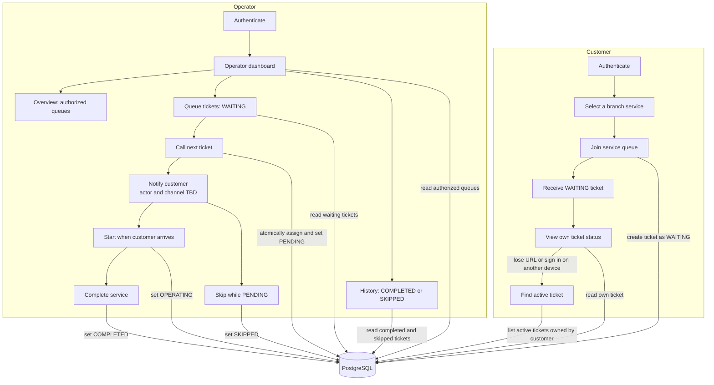

# User Journeys and Ticket Lifecycle

**Status:** Customer service selection, queue joining, active-ticket recovery, and own-ticket status are implemented. Operator processing and detailed later-sprint policies remain open.
**Sources:** group_work_specs_v1.pdf §6 Theme 9 and the user-provided diagrams.

A queue is the shared line for a branch service. A ticket is one customer's entry in that queue; it carries the lifecycle state. The diagram shows the complete intended Sprint 1 journey; the customer portion is implemented, while operator actions remain planned.

## Customer and operator journey

The dashboard history is a basic ticket view, not the future analytics or extended audit-history feature. Customer notification is a workflow step; whether it is a staff action or automated delivery, and the delivery channel, have not been decided.

### Ticket lifecycle

```mermaid
stateDiagram-v2
  [*] --> WAITING: Customer joins the service queue
  WAITING --> PENDING: Operator calls next; assign operator atomically
  PENDING --> OPERATING: Assigned operator starts service
  OPERATING --> COMPLETED: Assigned operator finishes service
  PENDING --> SKIPPED: Assigned operator skips ticket
  COMPLETED --> [*]
  SKIPPED --> [*]
```

A ticket can be skipped only while PENDING under the current proposal. COMPLETED and SKIPPED are terminal in this Sprint 1 model. The supplied Theme 9 brief places cancellation and no-show handling in later sprints but does not prescribe their state rules; the exact policy and any rejoin behavior remain open.

## Interpretation and open decisions

- The operator dashboard has an overview of authorized queues, a WAITING ticket view, and a read-only history of COMPLETED or SKIPPED tickets.
- A successful Call next action atomically assigns the WAITING ticket to the operator and changes it to PENDING.
- The journey includes notifying the customer after a call. The diagrams leave the actor and delivery channel open; they do not imply SMS, push, or another integration.
- This diagram shows the Sprint 1 slice. The official Theme 9 brief puts cancellation/no-show handling, multiple queues/counters, priority policy if applicable, and service summaries in later sprints. Exact transition and rejoin rules are not specified there and remain design decisions.
- The history view is basic ticket history, not analytics or an extended audit trail.
